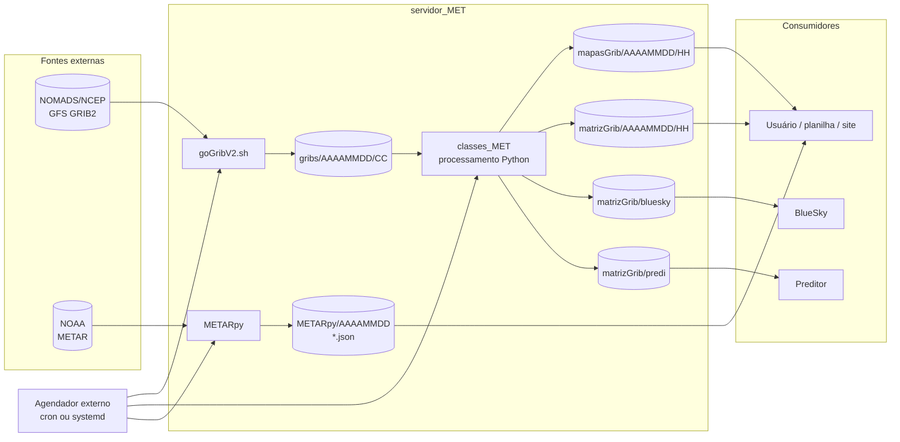
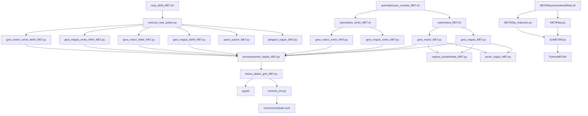

# 01 — Arquitetura

> **Estado após as Fases 3 e 4:** robustez operacional implementada e Fase 4
> validada localmente. Consulte [11-fase-3-resultados.md](11-fase-3-resultados.md)
> e [12-fase-4-resultados.md](12-fase-4-resultados.md) para comportamento atual,
> testes, overrides e limites; descrições abaixo preservam o histórico.

> **Estado:** este documento descreve a arquitetura e o comportamento do código
> original em `main`. As correções das Fases 1 e 2 estão resumidas em
> [09-fase-1-resultados.md](09-fase-1-resultados.md) e
> [10-fase-2-resultados.md](10-fase-2-resultados.md); o runbook atualizado está
> em [04-operacao.md](04-operacao.md).

## 1. Objetivo e escopo

O `servidor_MET` é um sistema de processamento meteorológico em lote. Ele transforma arquivos GFS GRIB2 em mapas PNG e matrizes CSV, e coleta observações METAR em JSON. O sistema foi projetado para rodar em um servidor Linux com diretórios fixos, acionado por um agendador externo.

Não há:

- API HTTP, serviço web ou endpoint;
- banco de dados relacional ou NoSQL;
- fila de mensagens, worker distribuído ou cache;
- agendador interno;
- controle de concorrência ou lock de execução;
- empacotamento (`setup.py`, `pyproject.toml`) ou `requirements.txt`.

O contrato entre as etapas é o **sistema de arquivos**: um script grava GRIB, outro lê GRIB, outro grava PNG/CSV, e os consumidores leem esses arquivos.

## 2. Visão de contexto

### Fronteiras do sistema

| Fronteira | Entrada | Saída | Observação |
|---|---|---|---|
| NOMADS/NCEP | URL HTTPS com GRIB2 | Arquivos em `gribs/` | Download por `wget`; sem autenticação |
| NOAA METAR | Texto METAR | JSON em `METARpy/` | Consulta feita pela biblioteca `PythonMETAR` |
| Consumidores GFS | PNG/CSV | — | Leitura direta do filesystem |
| BlueSky/preditor | CSV com colunas específicas | — | Unidades e ordem das colunas são o contrato |
| Agendador | Execução periódica | Códigos de saída e arquivos | Não versionado no projeto |

## 3. Componentes

### 3.1 Camada shell

| Arquivo | Responsabilidade | Executa |
|---|---|---|
| `goGribV2.sh` | Baixar GFS do NOMADS para a data local | `wget` |
| `remove_GRIBS_antigos.sh` | Remover GRIB e produtos do dia `hoje - 2` (corrigido na Fase 2) | `rm`, `date` |
| `bash/automatizacao_controle_MET.sh` | Orquestrar os produtos automáticos do dia | Wrappers de mapas/matrizes |
| `bash/automatiza_MET.sh` | Validar argumentos e chamar produtos escalares | `python3` |
| `bash/automatiza_vento_MET.sh` | Validar argumentos e chamar produtos de vento | `python3` |
| `bash/reqs_MAN_MET.sh` | Wrapper fino do CLI manual com `argparse` | `executa_reqs_param.py` |
| `METARpy/automatizaMetar.sh` | Criar diretório UTC e rodar coleta/tradução | `METARpy.py`, `METARpy_traduzido.py` |

Os wrappers automáticos usam `set -euo pipefail` e validam variável, nível,
região e coordenadas. O CLI manual usa `argparse` e aceita flags em qualquer
ordem desde a Fase 2 (D-05/D-14 corrigidos).

### 3.2 Núcleo Python

| Módulo | Papel |
|---|---|
| `classes_MET/controla_env.py` | Lê `environment/path.conf`, cria diretórios de data/hora e fornece caminhos de saída |
| `classes_MET/leitura_dados_grib_MET.py` | Escolhe ciclo/análise, tenta resoluções e abre GRIBs com `pygrib` |
| `classes_MET/processamento_dados_MET.py` | Mapeia variável/nível, seleciona mensagens GRIB e normaliza níveis |
| `classes_MET/parse_param_MET.py` | Interpreta argumentos dos fluxos automático e manual |
| `classes_MET/regioes_predefinidas_MET.py` | Define caixas lat/lon por região |
| `classes_MET/ponto_regiao_MET.py` | Cria uma caixa de ±5° em torno de um ponto |
| `classes_MET/poligono_regiao_MET.py` | Valida e cria um polígono retangular manual |
| `classes_MET/gera_mapas_MET.py` | Mapas escalares automáticos |
| `classes_MET/gera_matriz_MET.py` | Matrizes escalares automáticas |
| `classes_MET/gera_mapas_vento_MET.py` | Mapas de vento automáticos |
| `classes_MET/gera_matriz_vento_MET.py` | Matrizes de vento automáticas (BlueSky/predi) |
| `classes_MET/executa_reqs_param.py` | Dispatcher do fluxo manual |
| `classes_MET/gera_mapas_MAN_MET.py` | Mapas escalares manuais |
| `classes_MET/gera_matriz_MAN_MET.py` | Matrizes escalares manuais |
| `classes_MET/gera_mapas_vento_MAN_MET.py` | Mapas de vento manuais |
| `classes_MET/gera_matriz_vento_MAN_MET.py` | Matrizes de vento manuais |

### 3.3 Dados e saídas

| Caminho | Formato | Produtor | Consumidor |
|---|---|---|---|
| `gribs/AAAAMMDD/CC/` | GRIB2 | `goGribV2.sh` | `leitura_dados_grib_MET.py` |
| `mapasGrib/AAAAMMDD/HH/` | PNG | `gera_mapas_*` | Usuário |
| `matrizGrib/AAAAMMDD/HH/` | CSV | `gera_matriz_*` | Usuário/preditor |
| `matrizGrib/bluesky/AAAAMMDD/HH/` | CSV | `gera_matriz_vento_*` | BlueSky |
| `matrizGrib/predi/AAAAMMDD/HH/` | CSV | `gera_matriz_vento_*` | Preditor |
| `METARpy/AAAAMMDD/` | JSON | `METARpy.py` | Usuário |
| `METARpy/AAAAMMDD/*_traduzido.json` | JSON | `METARpy_traduzido.py` | Usuário |

### 3.4 Dependências externas

| Dependência | Uso | Situação no ambiente auditado |
|---|---|---|
| Python 3 | Execução dos módulos | Presente |
| `pygrib` | Leitura de GRIB2 | Presente (2.1.8) |
| `numpy` | Arrays e cálculos | Presente |
| `matplotlib` | Mapas | Presente |
| `mpl_toolkits.basemap` | Projeção e contornos | Presente |
| `PythonMETAR` | Parsing de METAR | **Ausente** no ambiente auditado |
| `wget` | Download GFS/METAR | Necessário no host |
| `bash`, `date`, `rm` | Orquestração/limpeza | Presente |

O diretório `METARpy/python-metar-master` contém um vendor alternativo, mas `GoMETAR.py` faz `from PythonMETAR import *`. O vendor `METARpy/PythonMETAR-1.0.0.1` é o pacote esperado; ele não está instalado no ambiente usado para esta auditoria.

## 4. Dependências entre módulos

### Observações sobre o grafo

- Todos os caminhos de GFS passam por `processamento_dados_MET.py`, que por sua vez instancia `leitura_dados_grib_MET.py`.
- `controla_env.py` é importado por `leitura_dados_grib_MET.py` e é instanciado no nível de módulo em vários geradores (`dir_save=controla_dirs_MET()`). Isso significa que **importar** um gerador já tenta ler `../environment/path.conf` e criar/entrar em diretórios. O diretório de trabalho importa.
- Os módulos manuais reutilizam o mesmo `processamento_dados_MET.py`; há ramos específicos (`processamento_dados_met_MAN`) para data/ciclo explícitos.
- `METARpy` é independente do núcleo GFS: não compartilha classes, configuração ou diretórios.

## 5. Decisões de projeto e trade-offs

| Decisão | Consequência |
|---|---|
| Filesystem como integração | Simples e inspecionável, mas sem transação, schema formal ou versionamento |
| Caminhos absolutos em `/media/MET/servidor_MET` | Funciona no host original, mas não é portável e quebra em checkouts/containers |
| Data/hora local para o fluxo automático | Simples, mas ambíguo em virada de dia, fuso e disponibilidade do ciclo GFS |
| `os.chdir` global em `controla_env` | Evita montar caminhos em cada chamada, mas acopla o processo ao diretório corrente |
| Um processo Python por produto | Isola falhas, mas repete leitura de GRIB e abertura de arquivos |
| Fallback de resolução por arquivo | Aumenta chance de gerar produto, mas pode misturar 0.25°/0.50°/1.00° no mesmo conjunto |
| CSV como contrato do BlueSky/preditor | Fácil de consumir, mas sem metadados de unidade/versão e sensível à ordem das colunas |
| Sem banco/fila | Menos infraestrutura, mas sem retry, idempotência, histórico ou controle de duplicidade |
| Sem testes/logging | Baixo custo inicial, alto custo de diagnóstico e regressão |

## 6. Modelo de execução

### 6.1 Fluxo automático

1. O agendador executa `goGribV2.sh` para baixar o dia local.
2. O agendador executa `bash/automatizacao_controle_MET.sh`.
3. O controlador entra em `bash/` e chama os wrappers com listas fixas de variáveis/níveis/regiões.
4. Cada wrapper entra em `classes_MET/` e executa um script Python.
5. O script Python:
   - lê `../environment/path.conf`;
   - escolhe o ciclo GFS pela hora local;
   - abre os quatro GRIBs (`f000`, `f006`, `f012`, `f018`) da análise escolhida;
   - seleciona variável/nível/região;
   - grava PNG/CSV no diretório de data/hora local.
6. O processo termina. Não há daemon, lock ou estado em memória compartilhado.

### 6.2 Fluxo manual

1. O usuário executa `bash/reqs_MAN_MET.sh` com flags em ordem fixa.
2. O wrapper chama `classes_MET/executa_reqs_param.py`.
3. O parser valida data, polígono, nível e saída.
4. O dispatcher escolhe mapas/matrizes e chama as classes `*_MAN_MET`.
5. Os arquivos são gravados em `-out`.

### 6.3 Fluxo METAR

1. O agendador executa `METARpy/automatizaMetar.sh`.
2. O shell cria/entra em `METARpy/AAAAMMDD/` (data local).
3. `METARpy.py` consulta cada estação e grava o JSON bruto.
4. `METARpy_traduzido.py` consulta novamente cada estação e grava o JSON traduzido.
5. Não há verificação de consistência entre as duas consultas.

## 7. Fronteiras de falha

| Etapa | Falha possível | Efeito observável |
|---|---|---|
| Download GFS | NOMADS indisponível, ciclo ainda não publicado, disco cheio | `gribs/` incompleto; produtos posteriores falham ou ficam ausentes |
| Leitura GRIB | Arquivo corrompido, resolução ausente, caminho errado | `pygrib` lança exceção; script termina com traceback |
| Seleção de ciclo | Hora local na primeira hora do ciclo | Corrigido na Fase 1; se regredir, produto rotulado com ciclo novo pode conter dados do anterior |
| Processamento | Variável/nível sem correspondência | Validação clara no AUT/MAN; mensagens específicas para `umidadeRel -ns`, `chuva` e `MN` |
| Geração de mapa | Basemap/dependência ausente, região inválida | Exceção; PNG não é gerado |
| Geração de matriz | Diretório de saída inexistente ou sem barra final | CLI valida o diretório e normaliza a barra final |
| METAR | `PythonMETAR` ausente, estação indisponível, JSON inválido | Coleta parcial ou exceção; escrita nova é atômica e UTC (Fase 2) |
| Limpeza | Virada de mês/ano | Corrigida na Fase 2 com `date -d "-2 days"`; testar com overrides |

## 8. Limitações e dívida técnica

- Não há `README` na raiz, `requirements.txt`, `pyproject.toml`, lint ou CI; esta entrega adiciona somente `docs/` e `tests/`.
- Não há logging estruturado; a maioria dos scripts usa `print` e deixa exceções subirem. Logging/lock é D-20 (Fase 3).
- Os wrappers foram endurecidos com `set -euo pipefail` na Fase 2; `goGribV2.sh` permanece congelado e fora desse tratamento.
- Há arquivos residuais: `classes_MET/controla_env.pyc` (Python 2.7), dois arquivos `.swp` do Vim, `bash/tstbash.sh`, `bash/tst.txt`, `variable_inside_list.txt`, `variables.txt`, `varMET`, `varPythonGrib` (D-19, Fase 3).
- O vendor `METARpy` ocupa aproximadamente 71 MB e inclui duas árvores (`PythonMETAR-1.0.0.1` e `python-metar-master`).
- Não há versionamento Git neste diretório.
- O código usa nomes e unidades heterogêneos (`hPa`, `feet`, `m`, `kt`, `ms**-1`) sem metadados nos CSV.

## 9. O que não existe (para evitar suposições)

- Não há endpoint para consultar produtos em tempo real.
- Não há banco de dados de observações ou produtos.
- Não há fila de requisições; requisições manuais são processos independentes.
- Não há autenticação/autorização; o acesso é controlado pelo filesystem.
- Não há scheduler, cron ou unit systemd dentro do repositório.
- Não há mecanismo de retry, dead-letter queue ou idempotência.
- Não há reconciliação entre o JSON bruto e o traduzido do METAR.
- Não há validação de que o GRIB baixado corresponde ao ciclo/data esperados.
