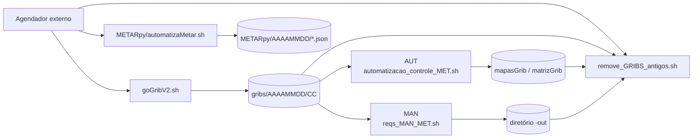
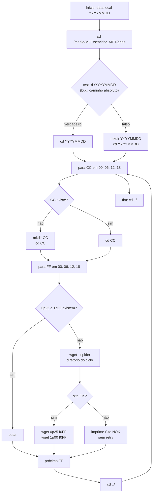
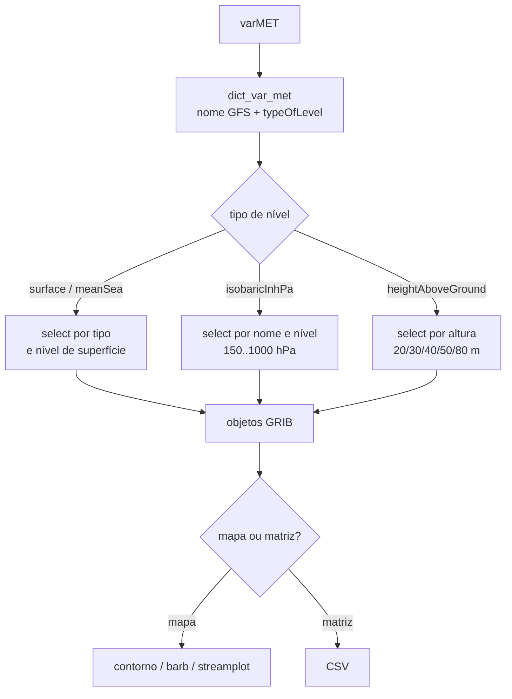
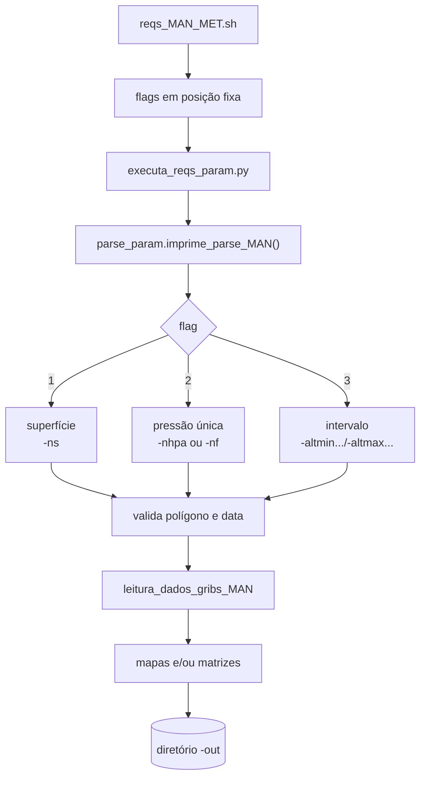
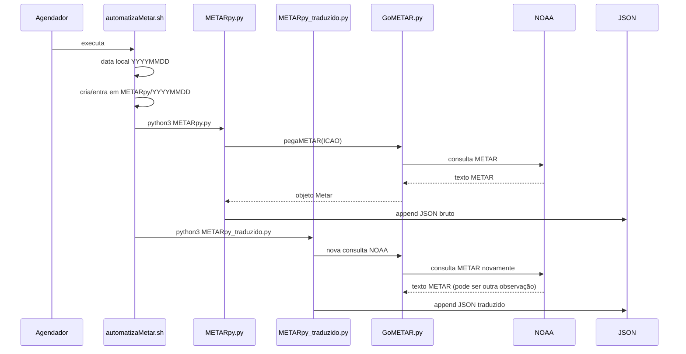
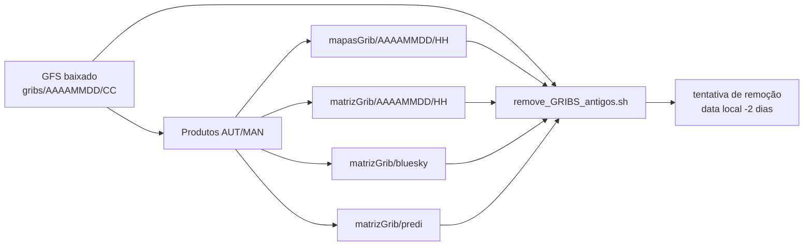

# 02 — Fluxos

Este documento descreve os quatro fluxos operacionais do `servidor_MET`:

1. ingestão de GFS;
2. geração automática de mapas/matrizes (AUT);
3. requisição manual (MAN);
4. coleta e tradução de METAR.

Os diagramas são Mermaid. Eles são legíveis como texto mesmo sem renderização, mas a visualização fica melhor em GitHub, GitLab, VS Code ou outro renderizador compatível.

## 1. Visão geral dos fluxos



Os fluxos AUT e MAN compartilham o mesmo núcleo de leitura/processamento, mas diferem em:

| Aspecto | AUT | MAN |
|---|---|---|
| Data | Data local corrente | `-datetime AAAAMMDD+AAP` explícito |
| Ciclo | Inferido da hora local | Informado na data |
| Região | `-r SP/RJ/...` ou `-ll lon lat` | `-lonmin/-lonmax/-latmin/-latmax` |
| Nível | `-n hPa` ou `-ns` | `-nhpa`, `-nf`, `-ns`, `-altminhpa/-altmaxhpa`, `-altminfeet/-altmaxfeet` |
| Saída | `mapasGrib/...` e `matrizGrib/...` | `-out` |
| Vento | `wind`/`winds` via wrapper | `-v wind`/`-v winds` |
| Execução | Lote fixo do controlador | Uma requisição por processo |

## 2. Ingestão GFS (`goGribV2.sh`)

### 2.1 Diagrama



### 2.2 O que é baixado

Para cada ciclo `CC` em `00/06/12/18` e cada previsão `FF` em `00/06/12/18`:

```text
gribs/AAAAMMDD/CC/gfs.tCCz.pgrb2.0p25.f0FF
gribs/AAAAMMDD/CC/gfs.tCCz.pgrb2.1p00.f0FF
```

Exemplo: `gribs/20221217/00/gfs.t00z.pgrb2.0p25.f006`.

O script **não baixa 0.50°**. A resolução 0.50° é suportada pela leitura como fallback, mas precisa existir previamente no diretório para ser usada. Também não baixa previsões acima de `f018`.

### 2.3 Condições e falhas

- A data é sempre a data local do servidor (`date +%Y`, `%m`, `%d`), não a data do ciclo UTC.
- A existência do diretório é testada em `/${data_completa}` (`goGribV2.sh:37`), um caminho absoluto na raiz. Na prática, o teste quase sempre é falso e o script cria o diretório relativo em `gribs/`; o bug não impede o fluxo normal, mas torna a condição enganosa.
- O download só ocorre se **as duas** resoluções (`0p25` e `1p00`) existirem. Se uma delas faltar, as duas são baixadas novamente.
- Não há verificação de tamanho, checksum, conteúdo ou correspondência entre data/ciclo e arquivo.
- Não há `set -e`; uma falha de `cd`, `mkdir` ou `wget` não interrompe o restante.
- Se o ciclo ainda não foi publicado no NOMADS, o `wget --spider` falha e o script apenas imprime `Site NOK!`, sem retry nem código de erro.
- O diretório `gribs/` precisa existir; o script faz `cd ${dir}` antes de criar qualquer coisa.

### 2.4 Leitura e fallback

`leitura_dados_grib_MET.py` tenta, para cada previsão, nesta ordem:

| Ordem | Arquivo | Observação |
|---|---|---|
| 1 | `gfs.tCCz.pgrb2.0p25.f0FF` | Principal |
| 2 | `gfs.tCCz.pgrb2.0p50.f0FF` | Suportado, mas não baixado pelo script |
| 3 | `gfs.tCCz.pgrb2.1p00.f0FF` | Baixado pelo script |
| 4 | `gfsAAAAMMDDCC00_000.grb` | Legado “USP/MASTER” |

O fallback é **por arquivo/previsão**. Se `f006` só existir em 1.00° e `f000` existir em 0.25°, o conjunto pode misturar resoluções. O nome do produto usa `iDirectionIncrementInDegrees` do objeto GRIB, então cada arquivo pode ter um valor diferente.

## 3. Fluxo automático (AUT)

### 3.1 Diagrama de sequência

```mermaid
sequenceDiagram
    participant S as Agendador
    participant C as automatizacao_controle_MET.sh
    participant W as automatiza_MET.sh / automatiza_vento_MET.sh
    participant P as Python (gera_*)
    participant L as leitura_dados_grib_MET.py
    participant O as mapasGrib / matrizGrib

    S->>C: executa
    C->>C: cd bash
    C->>W: chamadas fixas (linhas 17-73)
    W->>W: valida posição dos argumentos
    W->>P: python3 ...
    P->>L: leitura_dados_gribs_AUT()
    L->>L: escolhe ciclo pela hora local
    L-->>P: objetos GRIB f000..f018
    P->>P: seleciona variável, nível e região
    P->>O: grava PNG/CSV
    Note over C,O: Falhas silenciosas; o script termina com exit 1
```

### 3.2 O que o controlador realmente executa

O controlador tem 28 chamadas de produtos (sem contar comentários), mas nem todas produzem saída. A tabela abaixo é importante porque explica por que alguns produtos “existem no código” mas não aparecem no diretório.

| Linhas | Chamada | Efeito real | Motivo |
|---|---|---|---|
| 17-18 | `automatiza_vento_MET.sh -v winds -r SP/RJ` | **Nenhum** | Falta `-ns`; o wrapper só trata `-n` ou `-ns` |
| 20-24 | `automatiza_vento_MET.sh -v wind -n 1000/200 -r SP/RJ` | Mapas/matrizes de vento em pressão | Correto |
| 29-30 | `automatiza_MET.sh -v temp -n 1000 -r SP/RJ` | Mapas/matrizes de temperatura em 1000 hPa | Correto |
| 35-36 | `automatiza_MET.sh -v temps -ns -r SP/RJ` | Temperatura de superfície | Correto |
| 41,43 | `ps` | Comentado | Não executa |
| 42,44 | `prnm -ns` | Pressão ao nível médio do mar | Correto |
| 49-51 | `nuvem -n 700/500/200 -r SP` | Cobertura total de nuvens | Correto |
| 52 | `umidadeRel -ns -r SP` | **Executa, mas não grava** | O mapeamento é `isobaricInhPa`; a lista de superfície fica vazia |
| 54-56 | `nuvem -n 700/500/200 -r RJ` | Cobertura total de nuvens | Correto |
| 57 | `umidadeRel -ns -r RJ` | **Executa, mas não grava** | Mesmo bug |
| 62-65 | `automatiza_vento_MET.sh -n 1000/200 -r SP/RJ` | **Nenhum** | Falta `-v`; o wrapper exige `-v` |
| 70-71 | `chuvaConvec -ns -r SP/RJ` | Precipitação convectiva | Correto |
| 72-73 | `chuvaNaoConvec -ns -r SP/RJ` | **Precipitação total**, apesar do nome | Mapeamento `Total Precipitation`; ver D-13 |
| 75 | `exit 1` | Sempre retorna falha | Ver D-16 |

Consequência prática: **o controlador automático não gera o produto de vento superficial (`winds`)**. As linhas 17-18 (sem `-ns`) e 62-65 (sem `-v`) são no-op. Os ventos em níveis de pressão das linhas 20-24 (1000 e 200 hPa) **são gerados** normalmente. Para gerar o vento superficial, é preciso chamar o wrapper manualmente com a sintaxe correta (veja [04-operacao.md](04-operacao.md)) ou corrigir o controlador.

### 3.3 Seleção do ciclo

`leitura_dados_gribs_AUT` captura ano/mês/dia/hora/minuto locais (`leitura_dados_grib_MET.py:20-25`) e escolhe a análise assim (`:80-100`):

```text
i = 0; j = 1
enquanto i <= 2:
    se hora_grib[i] <= hora <= hora_grib[j]:
        se existe diretório hora_grib[i]:
            entra no diretório e abre f000/f006/f012/f018
    i++; j++
se hora >= 18:
    se existe "18":
        entra em "18" e abre os quatro arquivos
```

Há dois problemas combinados:

1. A comparação é inclusiva nos dois extremos (`<=`). Às 06:00–06:59, a primeira condição (`00 <= 6 <= 06`) também é verdadeira.
2. O `os.chdir` é relativo. Depois de entrar em `00`, a verificação `os.path.exists("06")` é feita dentro de `00`, não na raiz da data. Assim, a segunda análise é ignorada.

Resultado observado:

| Hora local | Ciclo usado pela leitura | Rótulo `hh_analise` nos produtos | Consequência |
|---|---|---|---|
| 00:00–00:59 | 00 | 00 | Correto |
| 01:00–05:59 | 00 | 00 | Correto |
| 06:00–06:59 | **00** | **06** | Produto rotulado 06 com dado de 00 |
| 07:00–11:59 | 06 | 06 | Correto |
| 12:00–12:59 | **06** | **12** | Produto rotulado 12 com dado de 06 |
| 13:00–17:59 | 12 | 12 | Correto |
| 18:00–18:59 | **12** | **18** | Produto rotulado 18 com dado de 12 |
| 19:00–23:59 | 18 | 18 | Correto |

O rótulo é calculado separadamente em `gera_mapas_MET.py:69-76`, `gera_matriz_MET.py:35-42` e nos equivalentes de vento, usando a comparação correta (`<=` no início, `<` no fim). Por isso o nome do arquivo pode dizer `06` enquanto o GRIB usado é de `00`. Esse é o bug D-04.

### 3.4 Seleção de variável e nível

O fluxo é:



- Para pressão, o nível pedido é “snapado” para o nível GFS mais próximo dentro de `150..1000 hPa`; valores fora da faixa são fixados em 150 ou 1000.
- Para superfície, o nível do produto é `surface`/`superficie`, independentemente do `-n` informado.
- Para altura, os níveis usados são `20, 30, 40, 50, 80 m`.
- Se a variável não tiver o tipo de nível esperado, a lista fica vazia. Em alguns casos isso gera produto vazio; em outros, `IndexError`/`AttributeError`.

### 3.5 Saídas do AUT

Os padrões completos estão em [03-dados-e-saidas.md](03-dados-e-saidas.md). Em resumo:

```text
mapasGrib/AAAAMMDD/HH/GFS_<res>_<REGIAO>_N<nivel>_<var>_<ana>_<dataDate>_<ff>.png
matrizGrib/AAAAMMDD/HH/GFS_<res>_<REGIAO>_N<nivel>_<var>_<ana>_<dataDate>_<ff>.csv
matrizGrib/bluesky/AAAAMMDD/HH/GFS_<res>_matriz_lat_lon_alt_angMET_VentoResult_<REGIAO>_N<nivel>_<ana>_<dataDate>_<ff>.csv
matrizGrib/predi/AAAAMMDD/HH/GFS_<res>_matriz_lat_lon_Vento_UVT_Predi_<REGIAO>_N<nivel>_<ana>_<dataDate>_<ff>.csv
```

O diretório `HH` é a hora local do início do processo, não necessariamente o ciclo GFS. Em execuções que atravessam a virada da hora, o objeto `dir_save` mantém a hora capturada no import.

## 4. Fluxo manual (MAN)

### 4.1 Diagrama



### 4.2 Sintaxe posicional

O wrapper **não aceita flags em qualquer ordem**. A ordem esperada é:

```text
reqs_MAN_MET.sh \
  -v <variavel> \
  -lonmin <lon> -lonmax <lon> \
  -latmin <lat> -latmax <lat> \
  <nivel> \
  -datetime <AAAAMMDD+AAP> \
  -out <diretorio/>
```

Onde `<nivel>` é um dos blocos:

| Bloco | Posições | Significado |
|---|---|---|
| `-nhpa 500` | 11-12 | Nível de pressão em hPa |
| `-nf 18000` | 11-12 | Altitude em pés, convertida para hPa |
| `-ns` | 11 | Superfície |
| `-altminhpa 500 -altmaxhpa 200` | 11-14 | Intervalo em hPa (atenção: o exemplo usa min > max) |
| `-altminfeet 50000 -altmaxfeet 20000` | 11-14 | Intervalo em pés, convertido para hPa |

Exemplo de nível único:

```bash
cd /media/MET/servidor_MET/bash
./reqs_MAN_MET.sh \
  -v temp \
  -lonmin -56 -lonmax -42 -latmin -28 -latmax -18 \
  -nhpa 500 \
  -datetime 202212170000 \
  -out /tmp/saida/
```

Exemplo de superfície:

```bash
./reqs_MAN_MET.sh \
  -v winds \
  -lonmin -56 -lonmax -42 -latmin -28 -latmax -18 \
  -ns \
  -datetime 202212170000 \
  -out /tmp/saida/
```

Exemplo de intervalo (a ordem `min > max` é a que funciona no código atual):

```bash
./reqs_MAN_MET.sh \
  -v temp \
  -lonmin -56 -lonmax -42 -latmin -28 -latmax -18 \
  -altminhpa 500 -altmaxhpa 200 \
  -datetime 202212170000 \
  -out /tmp/saida/
```

### 4.3 Parsing e validação

`parse_param.imprime_parse_MAN()` (`classes_MET/parse_param_MET.py:88-226`):

- lê `-v`, coordenadas, nível, data e saída;
- converte `-nf`/`-altminfeet`/`-altmaxfeet` para hPa com `converte_feet_to_hPa`;
- define `flag=1` para superfície (`nivel` é string), `flag=2` para nível único, `flag=3` para intervalo;
- retorna uma tupla de tamanho variável conforme o flag.

`executa_reqs_param.py` então:

- valida o polígono com `met_poligono_regiao` (`:119`, `:132`, `:146`);
- extrai data/ciclo com `validada_data` (`:120`, `:133`, `:147`);
- para `wind`/`winds`, chama mapas e matrizes (`:155-168`);
- para variáveis escalares, chama mapas e matrizes (`:170-183`);
- no flag 3 de vento, **as matrizes estão comentadas** (`:168`): só há mapas.

### 4.4 Limitações do MAN

- A data precisa ter exatamente 12 dígitos (`AAAAMMDD` + `AA` + `PP`). Oito dígitos deixam `ano`/`mes`/`dia` sem definição e geram `UnboundLocalError`.
- O polígono exige `lonmin < lonmax` e `latmin < latmax`; caso contrário `cria_poligono()` retorna `None` e o unpack em `executa_reqs_param.py` falha.
- O intervalo exige que o mínimo seja maior que o máximo na chamada atual; caso contrário, `idx_nivel_min`/`idx_nivel_max` não são definidos (`:85-98`).
- O diretório `-out` não é criado pelo código e deve terminar com `/`; caso contrário o prefixo é concatenado ao nome do arquivo.
- A região no nome do arquivo é uma string com espaços e dois-pontos (`LonMin:... LonMax:...`), o que exige cuidado em shell.
- O wrapper duplica o quarto argumento em todas as chamadas Python (`reqs_MAN_MET.sh:166,195,243,288`). Isso não quebra o parser atual porque o valor extra é ignorado, mas é frágil.
- O help diz que nível vazio significa superfície, mas o wrapper só executa com `-ns`; sem nível, nenhum Python é chamado.
- O MAN não usa `-r`; usa bounding box. A região `MN` citada no help do AUT não existe no dicionário de regiões (a chave de Manaus é `AM`).

## 5. Fluxo METAR

### 5.1 Diagrama



### 5.2 Estações

O dicionário em `METARpy.py:17-26` e `METARpy_traduzido.py:17-26` cobre:

| Chave | ICAO | Aeroporto |
|---|---|---|
| SP | SBGR | Guarulhos |
| RJ | SBGL | Galeão |
| CW | SBCT | Curitiba |
| PA | SBPA | Porto Alegre |
| BH | SBCF | Confins |
| BE | SBBE | Belém |
| MA | SBEG | Manaus |
| RF | SBRF | Recife |
| FZ | SBFZ | Fortaleza |

O comentário em `METARpy.py:13` diz `SBBEG`, mas o dicionário usa `SBEG`. O valor correto é `SBEG`.

### 5.3 Nome e conteúdo dos arquivos

O shell monta o diretório assim (`METARpy/automatizaMetar.sh:3-7`):

```text
METARpy/<data_ano><data_mes><data_dia>/
```

As variáveis `data_hora` e `data_min` são usadas na linha 7, mas **não são definidas** no script. O resultado é um diretório apenas com a data (`AAAAMMDD`), não com hora/minuto. Várias execuções no mesmo dia compartilham o mesmo diretório.

Os arquivos são nomeados pela estação e pelo timestamp da observação:

```text
METARpy/AAAAMMDD/SBGR202212170300.json
METARpy/AAAAMMDD/SBGR202212170300_traduzido.json
```

O JSON bruto tem a forma:

```json
{
  "data": [
    {
      "id_localidade ": "SBGR",
      "data ": "202212170300",
      "mensagem_metar ": "SBGR 170300Z 13004KT 9999 FEW013 17/15 Q1012"
    }
  ]
}
```

Observação: as chaves do JSON bruto têm **espaço no final** (`"id_localidade "`, `"data "`, `"mensagem_metar "`). O JSON traduzido usa chaves sem espaço.

O JSON traduzido tem a forma:

```json
{
  "data": [
    {
      "estacao": "SBGR",
      "data": "202212170300",
      "mensagem_metar": "SBGR 170300Z 13004KT 9999 FEW013 17/15 Q1012",
      "temperatura [C]": 17,
      "temperatura_pto_orvalho [C]": 15,
      "visibilidade [m]": "superior a 10000",
      "pressao_atmosferica [mb]": 1012,
      "condicao_nuvem": {
        "nuvem": [
          {
            "Tipo de nuvem ": "FEW",
            "Tipo de nuvem (nome completo) ": "Few",
            "Cobertura minima de nuvem [em oitavos]": "1",
            "Cobertura maxima de nuvem [em oitavos]": "2",
            "Altitude da nuvem [ft]": "1300"
          }
        ]
      },
      "vento": {
        "vento [KT]": 4,
        "rajada [KT]": "informacao ausente",
        "direcao_do_vento [graus]": 130,
        "coordenada_da_direcao_do_vento": "ESE",
        "variacao_do_vento": "informacao ausente"
      }
    }
  ]
}
```

### 5.4 Problemas estruturais do fluxo

- **Duas consultas independentes**: `METARpy.py` e `METARpy_traduzido.py` chamam `pegaMETAR` separadamente. Se a NOAA atualizar a observação entre as duas chamadas, o JSON bruto e o traduzido podem ter METARs diferentes.
- **Append sem separador**: ambos abrem em modo `"a"` e escrevem um JSON completo sem nova linha/separador (`METARpy.py:40`, `METARpy_traduzido.py:80`). Execuções repetidas no mesmo minuto concatenam objetos e geram JSON inválido.
- **Data da observação**: o timestamp usa o ano/mês atuais e o dia/hora/minuto do METAR (`METARpy.py:49-50`, `METARpy_traduzido.py:89-90`). Na virada do mês, uma observação do dia 31 pode ser gravada no mês seguinte.
- **Sem reconciliação**: não há verificação de que o arquivo bruto e o traduzido correspondem à mesma observação, nem de que o JSON é válido após a escrita.

## 6. Ciclo de vida dos dados



A retenção pretendida é de dois dias. O script calcula o dia com `date -d "-2 days" +%d`, mas combina com o **ano e mês correntes** (`remove_GRIBS_antigos.sh:9-15`). Nos dois primeiros dias de cada mês, a data formada é uma data futura do mês corrente ou um dia inexistente, e a limpeza não remove os dados antigos. O script também remove apenas GRIBs `0p25`; os `1p00` e legados permanecem.

## 7. Resumo das diferenças de comportamento

| Situação | AUT | MAN |
|---|---|---|
| Sem GRIB para a data | Lista vazia; erro posterior | Erro no `pygrib`/lista vazia |
| Hora exata do ciclo | Usa ciclo anterior na primeira hora (D-04) | Ciclo vem da data; não infere |
| Vento superficial | Não é gerado pelo controlador; se chamado, mapas e matriz do preditor usam V=U; matriz BlueSky usa V correto, mas altitude errada | Gerado se `-v winds -ns`; V correto; altitude errada no BlueSky |
| Umidade superficial | Sem saída | Falha com `-ns` |
| Precipitação | `chuvaNaoConvec` é total | Mesmo mapeamento |
| Saída | Diretórios fixos | `-out` |
| Código de saída | Controlador sempre `1` | Depende do Python; sem tratamento amigável |

Para detalhes de schemas, variáveis, níveis e regiões, consulte [03-dados-e-saidas.md](03-dados-e-saidas.md). Para os bugs e prioridades, consulte [05-diagnostico.md](05-diagnostico.md).
