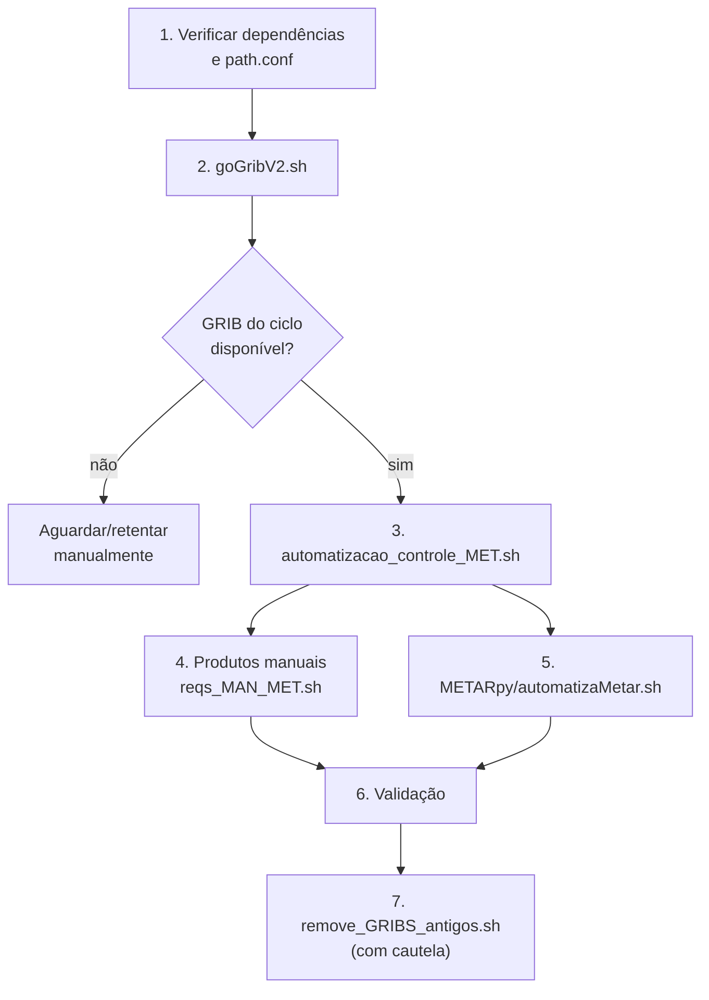

# 04 — Operação


> **Estado após as Fases 3 e 4:** robustez operacional implementada e Fase 4
> validada localmente. Consulte [11-fase-3-resultados.md](11-fase-3-resultados.md)
> e [12-fase-4-resultados.md](12-fase-4-resultados.md) para comportamento atual,
> testes, overrides e limites. O aceite dos consumidores e a promoção em
> produção continuam pendentes.

Este documento é um runbook operacional. Ele descreve pré-requisitos, ordem de execução, comandos, agendamento, validação e diagnóstico de falhas.

Para a primeira execução, siga a [instalação do zero](17-instalacao-do-zero.md)
e o [manual de testes MAN](15-manual-testes-de-execucao.md). Este runbook é a
referência da operação diária, que exige GRIBs atuais e diretórios preparados.

## 0. Usar o layout instalado pelo novo instalador

Ative seu Python com as dependências e carregue `bin/ativar.sh`. Para geração
automática em um ambiente operacional instalado em `/media/MET/servidor_MET`:

```bash
export MET_ROOT=/media/MET/servidor_MET
source "$MET_ROOT/bin/ativar.sh"
bash "$MET_ACTIVE_CODE/goGribV2.sh"
bash "$MET_ACTIVE_CODE/bash/automatizacao_controle_MET.sh"
```

Execute o controlador depois de conferir que os GRIBs do ciclo estão completos.
O downloader mantém seu destino fixo em `/media/MET/servidor_MET/gribs`.
`MET_PATH_CONF` configura os leitores/geradores, mas não muda esse destino.
As amostras históricas instaladas pelo guia do zero são usadas via MAN.

Para coletar METAR com o código ativo e gravar em uma pasta de dados gravável:

```bash
export METAR_REFERENCIA_UTC="$(date -u +%Y%m%d%H%M)"
METAR_OUT="$MET_ROOT/observacoes-METAR/${METAR_REFERENCIA_UTC:0:8}"
mkdir -p "$METAR_OUT"
(
  set -e
  cd "$METAR_OUT"
  python3 "$MET_ACTIVE_CODE/METARpy/METARpy.py"
  python3 "$MET_ACTIVE_CODE/METARpy/METARpy_traduzido.py"
)
```

O diretório de saída é externo ao pacote imutável em `current/code`. A coleta
usa a rede NOAA e o PythonMETAR instalado; retorna erro se uma estação falhar.
Agende uma execução por vez. As seções seguintes descrevem também o layout
original, em que os scripts ficavam diretamente sob `/media/MET/servidor_MET`.

Em cron/systemd, carregue o Python e `bin/ativar.sh` a cada execução e use
`$MET_ACTIVE_CODE` para acompanhar promoções e rollback. Um caminho fixo para
o checkout antigo continuará executando aquele código.

`bin/verificar.sh` confere a **instalação da campanha de aceitação**. Quando a
operação diária acrescentar ou substituir produtos, as contagens e hashes
podem divergir dessa campanha. Use a validação específica dos produtos diários;
o inventário histórico continua sendo a referência da release aceita.

## 1. Pré-requisitos

### 1.1 Sistema

- Linux com `bash`, `date` (GNU), `find`, `wget`, `rm`.
- Sistema de arquivos com `/media/MET/servidor_MET` montado e com espaço suficiente.
- Permissão de escrita nos diretórios `gribs/`, `mapasGrib/`, `matrizGrib/` e `METARpy/`.
- Fuso horário definido e conhecido. O fluxo automático usa a hora local para escolher o ciclo GFS e o diretório de saída.

### 1.2 Python

```bash
python3 --version
python3 -c "import pygrib, numpy, matplotlib; import mpl_toolkits.basemap; print('deps ok')"
python3 -c "import PythonMETAR; print('PythonMETAR ok')"
```

Dependências:

| Pacote | Uso | Verificação |
|---|---|---|
| `pygrib` | Ler GRIB2 | `python3 -c "import pygrib"` |
| `numpy` | Cálculos | `python3 -c "import numpy"` |
| `matplotlib` | Mapas | `python3 -c "import matplotlib"` |
| `mpl_toolkits.basemap` | Projeção/contornos | `python3 -c "import mpl_toolkits.basemap"` |
| `PythonMETAR` | Parsing METAR | `python3 -c "import PythonMETAR"` |

Se `PythonMETAR` não estiver instalado, use o vendor do próprio projeto ou defina `PYTHONPATH`:

```bash
# Opção 1: instalar a partir do vendor
cd /media/MET/servidor_MET/METARpy
pip3 install ./PythonMETAR-1.0.0.1

# Opção 2: usar sem instalar
export PYTHONPATH=/media/MET/servidor_MET/METARpy/PythonMETAR-1.0.0.1:$PYTHONPATH
```

O vendor `python-metar-master` é uma árvore alternativa e **não é o pacote importado** por `GoMETAR.py`.

### 1.3 Diretórios e configuração

Verifique:

```bash
ls -ld /media/MET/servidor_MET
test -f /media/MET/servidor_MET/environment/path.conf && echo "path.conf ok"
ls -ld /media/MET/servidor_MET/gribs /media/MET/servidor_MET/mapasGrib /media/MET/servidor_MET/matrizGrib
```

`environment/path.conf` deve conter:

```ini
dir_gribs=/media/MET/servidor_MET/gribs
dir_mapas=/media/MET/servidor_MET/mapasGrib
dir_matrizes=/media/MET/servidor_MET/matrizGrib
dir_matrizes_predi=/media/MET/servidor_MET/matrizGrib/predi
dir_matrizes_bluesky=/media/MET/servidor_MET/matrizGrib/bluesky
```

As cinco chaves acima são obrigatórias; se faltar alguma, a inicialização falha
com erro explícito. O arquivo é localizado em `environment/path.conf`, relativo
à raiz do projeto, **independentemente do diretório corrente**. Para usar outra
configuração, defina `MET_PATH_CONF` com o caminho absoluto do arquivo:

```bash
export MET_PATH_CONF=/media/MET/servidor_MET/environment/path.conf
```

Caminhos relativos dentro do arquivo são resolvidos em relação ao diretório do
próprio `path.conf`.

### 1.4 Diretório de trabalho

A configuração não depende mais do diretório corrente. Execute os wrappers a
partir de qualquer diretório; eles calculam os caminhos relativos ao próprio
script, e os módulos Python usam `environment/path.conf` na raiz do projeto ou
`MET_PATH_CONF`. Ainda assim, os comandos deste runbook usam `bash/` e
`classes_MET/` para manter a paridade com a operação histórica.

## 2. Ordem de execução



### 2.1 Baixar GFS

```bash
cd /media/MET/servidor_MET
./goGribV2.sh
```

- Usa a data local para montar `gribs/AAAAMMDD/`.
- Baixa `f000`, `f006`, `f012`, `f018` para os ciclos `00`, `06`, `12`, `18`.
- Não faz retry automático. Se o ciclo ainda não estiver publicado, apenas imprime `Site NOK!`.
- Confira o resultado:

```bash
find /media/MET/servidor_MET/gribs -type f -name '*.f0*' | wc -l
ls -lh /media/MET/servidor_MET/gribs/$(date +%Y%m%d)/*/ | head
```

### 2.2 Gerar produtos automáticos

```bash
cd /media/MET/servidor_MET/bash
./automatizacao_controle_MET.sh
```

- O controlador chama os wrappers em sequência e interrompe na primeira falha.
- Desde a Fase 2, o controlador gera `winds -ns` para SP e RJ e `wind` em 1000/200 hPa; o bloco duplicado de 1000/200 foi removido (D-05).
- A umidade relativa é gerada em **850 hPa** (`umidadeRel -n 850`). Não use `-ns`: o wrapper rejeita a chamada com mensagem clara (D-06).
- O controlador retorna **0 somente em sucesso** e propaga o primeiro código de erro real dos wrappers (D-16).
- Execuções concorrentes do controlador ou de um wrapper retornam **75** sem gerar produtos. Cada wrapper tem lock próprio e compartilha `products.lock` com a limpeza.
- Os locks ficam em `MET_LOCK_DIR` ou, por omissão, em `/tmp/metamorfose-UID`. Use o mesmo `MET_LOCK_DIR` em todas as instâncias locais que escrevem nos mesmos destinos.
- Cada produto é publicado de forma atômica (temporário no mesmo diretório + `os.replace`), e os logs de operação saem no stderr com destino e tamanho. A publicação é atômica por arquivo, não por lote inteiro.

```bash
cd /media/MET/servidor_MET/bash
./automatiza_vento_MET.sh -v winds -ns -r SP
./automatiza_vento_MET.sh -v wind -n 1000 -r SP
./automatiza_MET.sh -v umidadeRel -n 850 -r SP
```

### 2.3 Requisições manuais

As flags podem vir em qualquer ordem. Use `--help` para ver o catálogo e os exemplos:

```bash
cd /media/MET/servidor_MET/bash

# Nível único em hPa
./reqs_MAN_MET.sh \
  -v temp \
  -lonmin -56 -lonmax -42 -latmin -28 -latmax -18 \
  -nhpa 500 \
  -datetime 202212170000 \
  -out /tmp/saida/

# Superfície
./reqs_MAN_MET.sh \
  -v winds \
  -lonmin -56 -lonmax -42 -latmin -28 -latmax -18 \
  -ns \
  -datetime 202212170000 \
  -out /tmp/saida/

# Intervalo (as duas ordens produzem a mesma lista crescente)
./reqs_MAN_MET.sh \
  -v temp \
  -lonmin -56 -lonmax -42 -latmin -28 -latmax -18 \
  -altminhpa 200 -altmaxhpa 500 \
  -datetime 202212170000 \
  -out /tmp/saida/
```

Regras:

- O parser é `argparse`; as flags não dependem mais de posição e todos os campos obrigatórios são validados.
- `-out` deve ser um diretório **existente** e com permissão de escrita. A barra final é normalizada automaticamente.
- A data tem 12 dígitos: `AAAAMMDD` + `AA` + `PP` (análise + previsão).
- Informe exatamente um modo de nível: `-ns`, `-nhpa`, `-nf`, `-altminhpa/-altmaxhpa` ou `-altminfeet/-altmaxfeet`.
- `-nhpa` aceita 150–1000 hPa (com snap para o nível GFS mais próximo); `-nf` aceita 0–145000 pés; `-ns` é superfície.
- Os dois extremos do intervalo podem vir em qualquer ordem e passam pelo mesmo snap. Níveis iguais produzem um único elemento; fora da faixa retorna código 2.
- Vento com intervalo gera apenas mapas, não matrizes.
- `-v chuva` é rejeitado com mensagem que indica `chuvaConvec` e `chuvaNaoConvec`.
- Regiões `MN`/`-r` não existem no MAN; use a bounding box (`-lonmin/-lonmax/-latmin/-latmax`).
- As variáveis de superfície exigem `-ns`; `umidadeRel` exige nível de pressão (por exemplo, `-nhpa 850`).

### 2.4 Coletar METAR

```bash
cd /media/MET/servidor_MET/METARpy
./automatizaMetar.sh
```

- Calcula uma única referência UTC (`METAR_REFERENCIA_UTC`) e a compartilha com os dois scripts Python.
- Um lock em `MET_LOCK_DIR` impede duas coletas simultâneas; a segunda execução retorna 75.
- Cria o diretório `METARpy/AAAAMMDD/` com a **data UTC** da referência.
- Executa `METARpy.py` e `METARpy_traduzido.py`; cada estação grava um JSON bruto e um traduzido.
- A escrita é atômica (`.tmp` + `os.replace`) e sobrescreve a mesma estação + timestamp; reexecuções não concatenam JSON.
- Cada script consulta a NOAA separadamente; os dois JSONs ainda podem refletir observações diferentes.
- Para testes ou reprocessamento, os overrides são `METAR_BASE_DIR` e `METAR_REFERENCIA_UTC` (formato `AAAAMMDDHHMM`).
- Execute preferencialmente a cada 30–60 minutos, ou alinhado às observações de 00/06/12/18 UTC.
- Valide os JSONs depois da coleta:

```bash
python3 - <<'PY'
import glob, json
bad = []
for f in glob.glob('/media/MET/servidor_MET/METARpy/20*/*.json'):
    try:
        json.load(open(f))
    except Exception as e:
        bad.append((f, str(e)))
print('arquivos inválidos:', len(bad))
for f, e in bad[:20]:
    print(f, e)
PY
```

### 2.5 Limpeza

```bash
cd /media/MET/servidor_MET
./remove_GRIBS_antigos.sh
```

Comportamento:

- A data alvo é `hoje - 2 dias`, calculada com `date -d "-2 days" +"%Y%m%d"`, sem misturar ano/mês de hoje com o dia anterior.
- Remove os GRIBs `0p25`, `1p00` e legados `gfs????????????_???.grb` do dia alvo, nos ciclos `00/06/12/18`.
- Remove também os diretórios de produtos do dia alvo em `mapasGrib/`, `matrizGrib/`, `matrizGrib/bluesky/` e `matrizGrib/predi/`.
- Dados de outras datas não são tocados. O retorno é 0 em sucesso e 2 para data alvo ou data de referência com formato inválido ou data de calendário inexistente (por exemplo, `20260231`).
- Overrides para teste: `MET_BASE_DIR`, `MET_HOJE` (data de referência) e `MET_DATA_ALVO` (data alvo explícita).
- A limpeza compartilha `products.lock` com os wrappers e o faz em modo exclusivo; se houver geração em andamento, retorna 75 sem remover nada.
- Ainda assim, não agende limpeza e geração para o mesmo horário: o lock evita corrupção, mas uma execução pode falhar por concorrência.
- Considere fazer backup ou listar o que será removido antes de rodar (`find ... -maxdepth ... -print`).

## 3. Agendamento sugerido

O repositório não contém cron ou systemd. Uma agenda típica, assumindo servidor em `America/Sao_Paulo` (UTC-3), é:

```cron
# GFS: rodar após a disponibilidade de cada ciclo UTC
10 1,7,13,19 * * * cd /media/MET/servidor_MET && ./goGribV2.sh >> /var/log/servidor_MET/goGrib.log 2>&1

# Produtos automáticos: 10 minutos após o download
25 1,7,13,19 * * * cd /media/MET/servidor_MET/bash && ./automatizacao_controle_MET.sh >> /var/log/servidor_MET/aut.log 2>&1

# METAR: a cada 30 minutos
0,30 * * * * cd /media/MET/servidor_MET/METARpy && ./automatizaMetar.sh >> /var/log/servidor_MET/metar.log 2>&1

# Limpeza: uma vez por dia, em horário de baixo uso
30 4 * * * cd /media/MET/servidor_MET && ./remove_GRIBS_antigos.sh >> /var/log/servidor_MET/limpeza.log 2>&1
```

Justificativa dos horários:

- Às 01:10, 07:10, 13:10 e 19:10 locais, a hora local não está na primeira hora do ciclo (06/12/18). D-04 já foi corrigido, mas a folga continua útil para aguardar a publicação do GFS.
- Se o servidor estiver em UTC, ajuste os horários para 04:10, 10:10, 16:10 e 22:10 UTC.
- Os locks internos já impedem sobreposição: controlador, wrappers, METAR e limpeza retornam 75 quando encontram outra execução. Um `flock` externo é opcional e não substitui o `MET_LOCK_DIR` comum.
- Mantenha `MET_LOCK_DIR` no mesmo filesystem local para todas as instâncias; não há coordenação distribuída entre hosts.
- Crie `/var/log/servidor_MET/` com permissão de escrita antes de usar o cron sugerido.

## 4. Validação operacional

### 4.1 Checklist rápido

```bash
# 1. Arquivos gerados na última hora
find /media/MET/servidor_MET/mapasGrib -type f -mmin -60 | wc -l
find /media/MET/servidor_MET/matrizGrib -type f -mmin -60 | wc -l

# 2. Últimos produtos
find /media/MET/servidor_MET/mapasGrib -type f -printf '%T@ %p\n' | sort -n | tail -5
find /media/MET/servidor_MET/matrizGrib -type f -printf '%T@ %p\n' | sort -n | tail -5

# 3. Tamanho dos GRIBs
du -sh /media/MET/servidor_MET/gribs/*

# 4. Uso de disco
df -h /media/MET
```

### 4.2 Conferência de CSV

```bash
# Cabeçalho e primeiras linhas
head -3 /media/MET/servidor_MET/matrizGrib/$(date +%Y%m%d)/*/GFS_0.25_SP_N1000_temp_00_*.csv

# Contagem de linhas
wc -l /media/MET/servidor_MET/matrizGrib/$(date +%Y%m%d)/*/*.csv

# Verificar se há valores ausentes/NaN
grep -iE 'nan|inf' /media/MET/servidor_MET/matrizGrib/$(date +%Y%m%d)/*/*.csv | head
```

### 4.3 Conferência de sanidade

1. **Orientação**: escolher um CSV de temperatura e comparar um ponto ao norte e um ponto ao sul com um visualizador GFS. Os valores devem bater; se estiverem trocados, houve regressão de D-01.
2. **Ciclo**: gerar um produto às 06:30 e conferir se o GRIB usado é o ciclo 06; se for 00, houve regressão de D-04.
3. **Vento**: comparar U/V/direção com um ponto de referência; a direção deve estar em `[0, 360)`.
4. **Altura do vento**: conferir `hMET` para 20 m (~65,6 ft) e 80 m (~262,5 ft); valores de 55.696–76.487 ft indicam regressão de D-03.
5. **Umidade**: `umidadeRel -ns` deve falhar com mensagem clara; `umidadeRel -n 850` deve gerar CSV/PNG com valores entre 0 e 100.
6. **METAR**: rodar o validador JSON e comparar bruto × traduzido da mesma estação/horário. Novas execuções devem sobrescrever atomicamente, sem concatenar (D-07/D-08).
7. **Limpeza**: em ambiente de teste, usar `MET_BASE_DIR`/`MET_HOJE` e conferir que somente o dia `hoje - 2` foi removido.
8. **Concorrência**: iniciar dois controladores ao mesmo tempo; o segundo deve retornar 75 sem gerar produtos. Repetir com limpeza + geração para conferir o `products.lock`.
9. **Idempotência**: reexecutar o mesmo produto e conferir que o CSV/PNG é sobrescrito atomicamente, sem linhas duplicadas e sem arquivos temporários remanescentes.

## 5. Troubleshooting

| Sintoma | Causa provável | Ação |
|---|---|---|
| Nenhum arquivo em `mapasGrib`/`matrizGrib` | GRIB ausente, `path.conf` inacessível ou incompleto | Conferir `gribs/AAAAMMDD/CC`, `environment/path.conf`/`MET_PATH_CONF` e os logs dos wrappers |
| Controlador termina com código diferente de zero | O primeiro wrapper que falhou retornou esse código | Ler o stderr do controlador para identificar a chamada e corrigir a causa; o controlador não mascara mais o erro |
| Controlador ou wrapper retorna 75 | Outra geração, coleta METAR ou limpeza está em andamento | Aguardar a execução atual; conferir se todas as instâncias usam o mesmo `MET_LOCK_DIR` |
| Lock preso após queda | O processo morreu e o `flock` foi liberado pelo kernel; o arquivo `.lock` permanece | Não remover o arquivo durante uma execução; se não houver processo ativo, o lock é reutilizado automaticamente |
| Vento superficial não aparece | `winds` não foi gerado ou o GRIB não tem os níveis 20/30/40/50/80 m | Conferir as chamadas `winds -ns` do controlador e os logs; rodar `automatiza_vento_MET.sh -v winds -ns -r SP` para isolar |
| Umidade relativa não aparece | `umidadeRel` só existe em pressão; `-ns` é inválido | Usar `-n 850`; o controlador já usa 850 hPa. `-ns` retorna erro claro |
| JSON METAR inválido | Arquivos históricos anteriores à escrita atômica (D-07) | Novas execuções sobrescrevem atomicamente; validar o acervo antigo e reparar/ignorar conforme o consumidor |
| `ModuleNotFoundError: PythonMETAR` | Pacote não instalado | Instalar vendor ou exportar `PYTHONPATH` |
| `ImportError: No module named mpl_toolkits.basemap` | Basemap ausente | Instalar `basemap`/`basemap-data-hires` |
| Produto com ciclo errado na primeira hora | D-04 | Rodar após `HH:10` ou corrigir a seleção de ciclo |
| Vento superficial com V errado | D-02 | Corrigir `vSupe` no mapa AUT e na matriz do preditor; o MAN já usa V correto |
| Altitude de vento superficial absurda | D-03 | Corrigir conversão para metros × 3,28084 |
| Nenhum Python chamado no MAN | Flag obrigatória ausente ou combinação inválida | Ver `--help`; o `argparse` retorna código 2 com a mensagem. As flags podem vir em qualquer ordem |
| CSV/PNG no lugar errado | `-out` inexistente, sem permissão ou apontando para arquivo | Criar o diretório e conferir a mensagem de validação do CLI |
| CSV/PNG parcial ou truncado | Execução antiga interrompida antes da escrita atômica | Reexecutar o produto; a versão anterior é preservada até a promoção do temporário |
| Erro de nível no MAN | Nível fora de 150–1000 hPa ou mais de um modo de nível | Usar um único modo (`-ns`, `-nhpa`, `-nf` ou intervalo) dentro da faixa |
| `KeyError: 'MN'` | Região inexistente | Usar `AM`, `SP`, `RJ` etc.; o MAN usa bounding box, não `-r` |
| `FileNotFoundError` em `path.conf` | Arquivo ausente ou `MET_PATH_CONF` inválido | Conferir `environment/path.conf` ou definir `MET_PATH_CONF` absoluto e legível |
| Disco cheio | Retenção/consumo de GRIB | Conferir o agendamento da limpeza, o espaço livre e os logs; a data alvo agora é calculada corretamente |

## 6. Monitoramento e observabilidade

O sistema atual não tem métricas, logs estruturados nem alertas. Recomendações mínimas:

- Os logs de produto saem no stderr com timestamp, operação, status, destino e tamanho; o controlador retorna o primeiro erro real e 75 em concorrência.
- Registrar em log o ciclo GFS escolhido, a resolução de cada arquivo, a data/ciclo solicitados, o número de mensagens GRIB, o número de linhas do CSV e o caminho de saída.
- Alertar se:
  - nenhum arquivo novo aparecer em uma janela de 6 horas;
  - o número de arquivos por ciclo cair significativamente;
  - houver JSON inválido;
  - o disco passar de 80%;
  - o ciclo usado divergir do esperado;
  - o controlador retornar código diferente de 0 ou 75.
- Guardar o stdout/stderr de cada script com timestamp.

## 7. Backup, retenção e recuperação

- O projeto passou a ter histórico Git na Fase 0. Ainda assim, faça backup de `environment/path.conf` e dos produtos antes de qualquer intervenção.
- Os produtos podem ser regenerados a partir dos GRIBs enquanto eles existirem; depois da limpeza, é necessário baixar novamente do NOMADS (nem todo ciclo antigo fica disponível).
- O METAR histórico é o dado mais difícil de reconstruir; faça backup de `METARpy/20*` antes de mexer nos scripts.
- Em caso de corrupção de JSON, preserve o arquivo original e corrija em cópia; as novas execuções não concatenam mais.
- Produtos gerados antes das correções da Fase 1 (D-01/D-02/D-03/D-04/D-12) devem ser tratados como suspeitos e reprocessados ou descartados.
- A limpeza da Fase 2 remove somente o dia alvo, mas o `rm -rf` continua sendo destrutivo: teste com `MET_BASE_DIR` e `MET_HOJE` antes de usar em produção.

## 8. Segurança e limites

- Todas as fontes são públicas (NOMADS/NOAA); não há credenciais no projeto.
- O acesso é controlado por permissões de filesystem.
- Evite executar downloads em paralelo agressivo para não bloquear/abusar do NOMADS.
- O CLI manual e os wrappers agora validam variável, nível, coordenadas, data e diretório de saída, mas continuam sendo ferramentas operacionais: restrinja quem pode executá-las.
- Nomes de região não podem conter `/`, `\` ou `..`; coordenadas precisam ser finitas e estar em ±180° de longitude e ±90° de latitude. Caixas que cruzam o antimeridiano não são suportadas (D-21).
- O `rm -rf` da limpeza deve ser testado com os overrides antes de rodar em produção; a validação de data reduz, mas não elimina, o risco de remoção indevida.

## Estado da Fase 4

A implementacao e a validacao local estao em [12-fase-4-resultados.md](12-fase-4-resultados.md).
O rollout real e o aceite dos consumidores externos ainda estao pendentes.
Os nomes, headers, unidades e o downloader permanecem preservados.
