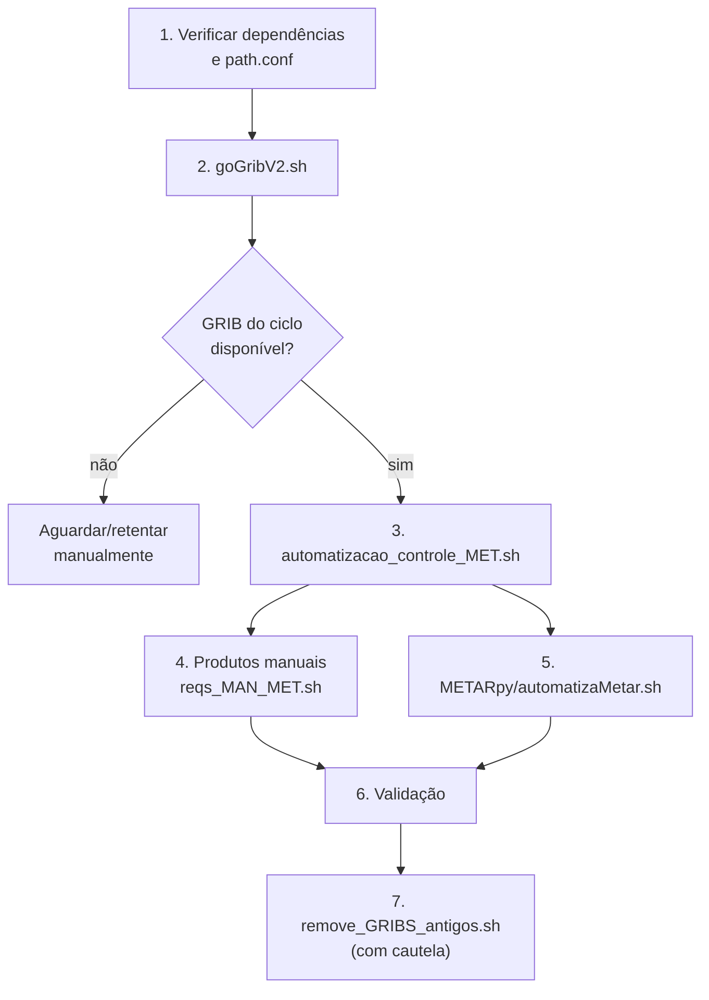

# 04 — Operação

Este documento é um runbook operacional. Ele descreve pré-requisitos, ordem de execução, comandos, agendamento, validação e diagnóstico de falhas.

> **Atenção**: este checkout não contém `/media/MET/servidor_MET`, e o pacote `PythonMETAR` não está instalado no ambiente auditado. Os comandos abaixo pressupõem o host de produção com os caminhos e as dependências corretas.

## 1. Pré-requisitos

### 1.1 Sistema

- Linux com `bash`, `date` (GNU), `find`, `wget`, `rm`.
- Sistema de arquivos com `/media/MET/servidor_MET` montado e com espaço suficiente.
- Permissão de escrita nos diretórios `gribs/`, `mapasGrib/`, `matrizGrib/` e `METARpy/`.
- Fuso horário definido e conhecido. O fluxo automático usa a hora local para escolher o ciclo GFS e o diretório de saída.

### 1.2 Python

```bash
python3 --version
python3 -c "import pygrib, numpy, matplotlib; import mpl_toolkits.basemap; print('deps ok')"
python3 -c "import PythonMETAR; print('PythonMETAR ok')"
```

Dependências:

| Pacote | Uso | Verificação |
|---|---|---|
| `pygrib` | Ler GRIB2 | `python3 -c "import pygrib"` |
| `numpy` | Cálculos | `python3 -c "import numpy"` |
| `matplotlib` | Mapas | `python3 -c "import matplotlib"` |
| `mpl_toolkits.basemap` | Projeção/contornos | `python3 -c "import mpl_toolkits.basemap"` |
| `PythonMETAR` | Parsing METAR | `python3 -c "import PythonMETAR"` |

Se `PythonMETAR` não estiver instalado, use o vendor do próprio projeto ou defina `PYTHONPATH`:

```bash
# Opção 1: instalar a partir do vendor
cd /media/MET/servidor_MET/METARpy
pip3 install ./PythonMETAR-1.0.0.1

# Opção 2: usar sem instalar
export PYTHONPATH=/media/MET/servidor_MET/METARpy/PythonMETAR-1.0.0.1:$PYTHONPATH
```

O vendor `python-metar-master` é uma árvore alternativa e **não é o pacote importado** por `GoMETAR.py`.

### 1.3 Diretórios e configuração

Verifique:

```bash
ls -ld /media/MET/servidor_MET
test -f /media/MET/servidor_MET/environment/path.conf && echo "path.conf ok"
ls -ld /media/MET/servidor_MET/gribs /media/MET/servidor_MET/mapasGrib /media/MET/servidor_MET/matrizGrib
```

`environment/path.conf` deve conter:

```ini
dir_gribs=/media/MET/servidor_MET/gribs
dir_mapas=/media/MET/servidor_MET/mapasGrib
dir_matrizes=/media/MET/servidor_MET/matrizGrib
dir_matrizes_predi=/media/MET/servidor_MET/matrizGrib/predi
dir_matrizes_bluesky=/media/MET/servidor_MET/matrizGrib/bluesky
```

### 1.4 Diretório de trabalho

Os módulos Python abrem `../environment/path.conf`. Execute a partir de `bash/` ou de `classes_MET/`; ambos resolvem para `environment/` no nível do projeto. Evite executar a partir da raiz do projeto.

## 2. Ordem de execução



### 2.1 Baixar GFS

```bash
cd /media/MET/servidor_MET
./goGribV2.sh
```

- Usa a data local para montar `gribs/AAAAMMDD/`.
- Baixa `f000`, `f006`, `f012`, `f018` para os ciclos `00`, `06`, `12`, `18`.
- Não faz retry automático. Se o ciclo ainda não estiver publicado, apenas imprime `Site NOK!`.
- Confira o resultado:

```bash
find /media/MET/servidor_MET/gribs -type f -name '*.f0*' | wc -l
ls -lh /media/MET/servidor_MET/gribs/$(date +%Y%m%d)/*/ | head
```

### 2.2 Gerar produtos automáticos

```bash
cd /media/MET/servidor_MET/bash
./automatizacao_controle_MET.sh
```

- O controlador chama os wrappers em sequência.
- **O controlador termina com `exit 1` mesmo quando tudo dá certo** (`automatizacao_controle_MET.sh:75`). Não use apenas o código de saída para decidir se houve sucesso; verifique os arquivos gerados.
- Os ventos em 1000/200 hPa são gerados pelas linhas 20-24, mas o **vento superficial (`winds`) não é gerado** pelo controlador atual (D-05). As linhas 17-18 e o bloco duplicado de 1000/200 das linhas 62-65 são no-op. Para gerar o vento superficial, chame o wrapper manualmente:

```bash
cd /media/MET/servidor_MET/bash
./automatiza_vento_MET.sh -v wind -n 1000 -r SP
./automatiza_vento_MET.sh -v winds -ns -r SP   # vento quase-superfície; ainda contém D-02/D-03
```

- A umidade relativa superficial também não sai pelo controlador (D-06). O comando executa, mas não grava.

### 2.3 Requisições manuais

Sintaxe e ordem:

```bash
cd /media/MET/servidor_MET/bash

# Nível único em hPa
./reqs_MAN_MET.sh \
  -v temp \
  -lonmin -56 -lonmax -42 -latmin -28 -latmax -18 \
  -nhpa 500 \
  -datetime 202212170000 \
  -out /tmp/saida/

# Superfície
./reqs_MAN_MET.sh \
  -v winds \
  -lonmin -56 -lonmax -42 -latmin -28 -latmax -18 \
  -ns \
  -datetime 202212170000 \
  -out /tmp/saida/

# Intervalo (min > max é a ordem que funciona hoje)
./reqs_MAN_MET.sh \
  -v temp \
  -lonmin -56 -lonmax -42 -latmin -28 -latmax -18 \
  -altminhpa 500 -altmaxhpa 200 \
  -datetime 202212170000 \
  -out /tmp/saida/
```

Regras:

- A ordem das flags é posicional; não reordene.
- `-out` deve existir e terminar com `/`.
- A data tem 12 dígitos: `AAAAMMDD` + `AA` + `PP` (análise + previsão).
- `-nhpa` = nível em hPa; `-nf` = altitude em pés; `-ns` = superfície.
- `-altminhpa`/`-altmaxhpa` e `-altminfeet`/`-altmaxfeet` = intervalo.
- Vento com intervalo gera apenas mapas, não matrizes.
- `-v chuva` não existe; use `chuvaConvec` ou `chuvaNaoConvec`.
- O MAN não usa regiões predefinidas (`-r`); ele usa bounding box (`-lonmin/-lonmax/-latmin/-latmax`).

### 2.4 Coletar METAR

```bash
cd /media/MET/servidor_MET/METARpy
./automatizaMetar.sh
```

- Cria o diretório `METARpy/AAAAMMDD/` com a data local.
- Executa `METARpy.py` e `METARpy_traduzido.py`.
- Cada script consulta a NOAA separadamente; os dois JSONs podem refletir observações diferentes.
- Execute preferencialmente a cada 30–60 minutos, ou alinhado às observações de 00/06/12/18 UTC.
- Valide os JSONs depois da coleta:

```bash
python3 - <<'PY'
import glob, json
bad = []
for f in glob.glob('/media/MET/servidor_MET/METARpy/20*/*.json'):
    try:
        json.load(open(f))
    except Exception as e:
        bad.append((f, str(e)))
print('arquivos inválidos:', len(bad))
for f, e in bad[:20]:
    print(f, e)
PY
```

### 2.5 Limpeza

```bash
cd /media/MET/servidor_MET
./remove_GRIBS_antigos.sh
```

Cuidados:

- O script tenta remover dados de dois dias atrás.
- Nos dois primeiros dias de cada mês ele calcula a data errada (D-10) e não remove os dados antigos.
- Remove apenas GRIBs `0p25`; `1p00` e legados permanecem.
- Não execute em paralelo com a geração de produtos.
- Considere fazer backup ou listar o que será removido antes de rodar (`find ... -maxdepth ... -print`).

## 3. Agendamento sugerido

O repositório não contém cron ou systemd. Uma agenda típica, assumindo servidor em `America/Sao_Paulo` (UTC-3), é:

```cron
# GFS: rodar após a disponibilidade de cada ciclo UTC
10 1,7,13,19 * * * cd /media/MET/servidor_MET && ./goGribV2.sh >> /var/log/servidor_MET/goGrib.log 2>&1

# Produtos automáticos: 10 minutos após o download
25 1,7,13,19 * * * cd /media/MET/servidor_MET/bash && ./automatizacao_controle_MET.sh >> /var/log/servidor_MET/aut.log 2>&1

# METAR: a cada 30 minutos
0,30 * * * * cd /media/MET/servidor_MET/METARpy && ./automatizaMetar.sh >> /var/log/servidor_MET/metar.log 2>&1

# Limpeza: uma vez por dia, em horário de baixo uso
30 4 * * * cd /media/MET/servidor_MET && ./remove_GRIBS_antigos.sh >> /var/log/servidor_MET/limpeza.log 2>&1
```

Justificativa dos horários:

- Às 01:10, 07:10, 13:10 e 19:10 locais, a hora local não está na primeira hora do ciclo (06/12/18), evitando o bug D-04. O ciclo 00 é usado das 00:00 às 05:59 e já está disponível.
- Se o servidor estiver em UTC, ajuste os horários para 04:10, 10:10, 16:10 e 22:10 UTC.
- Use `flock` se houver risco de sobreposição:

```bash
flock -n /var/lock/servidor_MET_aut.lock -c 'cd /media/MET/servidor_MET/bash && ./automatizacao_controle_MET.sh'
```

- Crie `/var/log/servidor_MET/` com permissão de escrita antes de usar o cron sugerido.

## 4. Validação operacional

### 4.1 Checklist rápido

```bash
# 1. Arquivos gerados na última hora
find /media/MET/servidor_MET/mapasGrib -type f -mmin -60 | wc -l
find /media/MET/servidor_MET/matrizGrib -type f -mmin -60 | wc -l

# 2. Últimos produtos
find /media/MET/servidor_MET/mapasGrib -type f -printf '%T@ %p\n' | sort -n | tail -5
find /media/MET/servidor_MET/matrizGrib -type f -printf '%T@ %p\n' | sort -n | tail -5

# 3. Tamanho dos GRIBs
du -sh /media/MET/servidor_MET/gribs/*

# 4. Uso de disco
df -h /media/MET
```

### 4.2 Conferência de CSV

```bash
# Cabeçalho e primeiras linhas
head -3 /media/MET/servidor_MET/matrizGrib/$(date +%Y%m%d)/*/GFS_0.25_SP_N1000_temp_00_*.csv

# Contagem de linhas
wc -l /media/MET/servidor_MET/matrizGrib/$(date +%Y%m%d)/*/*.csv

# Verificar se há valores ausentes/NaN
grep -iE 'nan|inf' /media/MET/servidor_MET/matrizGrib/$(date +%Y%m%d)/*/*.csv | head
```

### 4.3 Conferência de sanidade (após correções)

1. **Orientação**: escolher um CSV de temperatura de superfície e comparar um ponto ao norte e um ponto ao sul com um visualizador GFS. Se os valores estiverem trocados, D-01 está presente.
2. **Ciclo**: gerar um produto às 06:30 e conferir se o GRIB usado é o ciclo 06; se for 00, D-04 está presente.
3. **Vento**: comparar U/V/direção com um ponto de referência; conferir se a direção está em 0–360 (D-12).
4. **Altura do vento**: conferir `hMET` para 20 m (~65,6 ft) e 80 m (~262,5 ft); valores de 55.696–76.487 ft indicam D-03.
5. **Umidade**: verificar se existe algum arquivo de `umidadeRel` superficial (D-06).
6. **METAR**: rodar o validador JSON e comparar bruto × traduzido da mesma estação/horário (D-07/D-08).

## 5. Troubleshooting

| Sintoma | Causa provável | Ação |
|---|---|---|
| Nenhum arquivo em `mapasGrib`/`matrizGrib` | GRIB ausente, `path.conf` inacessível, diretório de trabalho errado | Conferir `gribs/AAAAMMDD/CC`, `environment/path.conf` e executar a partir de `bash/`/`classes_MET/` |
| Controlador termina com erro 1 | `exit 1` fixo no final (`automatizacao_controle_MET.sh:75`) | Ignorar o código e validar arquivos; corrigir o script |
| Vento superficial não aparece | Chamadas `winds` no-op do controlador (D-05) | Chamar `automatiza_vento_MET.sh -v winds -ns -r ...` manualmente; ventos em 1000/200 hPa já são gerados |
| Umidade relativa não aparece | Mapeamento para `isobaricInhPa` e sem superfície (D-06) | Não usar `-ns`; corrigir mapeamento/computação |
| JSON METAR inválido | Append sem separador (D-07) | Remover duplicatas, reescrever com `"w"`/JSON Lines |
| `ModuleNotFoundError: PythonMETAR` | Pacote não instalado | Instalar vendor ou exportar `PYTHONPATH` |
| `ImportError: No module named mpl_toolkits.basemap` | Basemap ausente | Instalar `basemap`/`basemap-data-hires` |
| Produto com ciclo errado na primeira hora | D-04 | Rodar após `HH:10` ou corrigir a seleção de ciclo |
| Vento superficial com V errado | D-02 | Corrigir `vSupe` no mapa AUT e na matriz do preditor; o MAN já usa V correto |
| Altitude de vento superficial absurda | D-03 | Corrigir conversão para metros × 3,28084 |
| Nenhum Python chamado no MAN | Flags fora de ordem/faltando | Seguir a ordem posicional exata; usar `-ns`/`-nhpa`/intervalo |
| CSV/PNG no lugar errado | `-out` sem `/` final | Terminar `-out` com `/` |
| `UnboundLocalError` no MAN | Data sem 12 dígitos ou intervalo min<max | Usar 12 dígitos e min>max |
| `KeyError: 'MN'` | Região inexistente | Usar `AM`, `SP`, `RJ` etc. |
| `FileNotFoundError: ../environment/path.conf` | Diretório de trabalho errado | Executar de `bash/` ou `classes_MET/` |
| Disco cheio | Retenção/consumo de GRIB | Conferir D-10, limpar manualmente com cuidado |

## 6. Monitoramento e observabilidade

O sistema atual não tem métricas, logs estruturados nem alertas. Recomendações mínimas:

- Registrar em log o ciclo GFS escolhido, a resolução de cada arquivo, a data/ciclo solicitados, o número de mensagens GRIB, o número de linhas do CSV e o caminho de saída.
- Alertar se:
  - nenhum arquivo novo aparecer em uma janela de 6 horas;
  - o número de arquivos por ciclo cair significativamente;
  - houver JSON inválido;
  - o disco passar de 80%;
  - o ciclo usado divergir do esperado.
- Guardar o stdout/stderr de cada script com timestamp.
- Não confiar apenas no código de saída do controlador (D-16).

## 7. Backup, retenção e recuperação

- Não há Git no diretório. Faça backup do código e de `environment/path.conf` antes de qualquer correção.
- Os produtos podem ser regenerados a partir dos GRIBs enquanto eles existirem; depois da limpeza, é necessário baixar novamente do NOMADS (nem todo ciclo antigo fica disponível).
- O METAR histórico é o dado mais difícil de reconstruir; faça backup de `METARpy/20*` antes de mexer nos scripts.
- Em caso de corrupção de JSON, preserve o arquivo original e corrija em cópia.
- Após corrigir D-01/D-02/D-03/D-04, os produtos gerados antes da correção devem ser tratados como suspeitos e reprocessados ou descartados.

## 8. Segurança e limites

- Todas as fontes são públicas (NOMADS/NOAA); não há credenciais no projeto.
- O acesso é controlado por permissões de filesystem.
- Evite executar downloads em paralelo agressivo para não bloquear/abusar do NOMADS.
- Não há validação de entrada; trate o CLI manual como confiável e restrinja quem pode executá-lo.
- O `rm -r` da limpeza deve ser revisado antes de rodar em produção; um erro de data pode remover diretório inesperado se a lógica for alterada sem cuidado.
