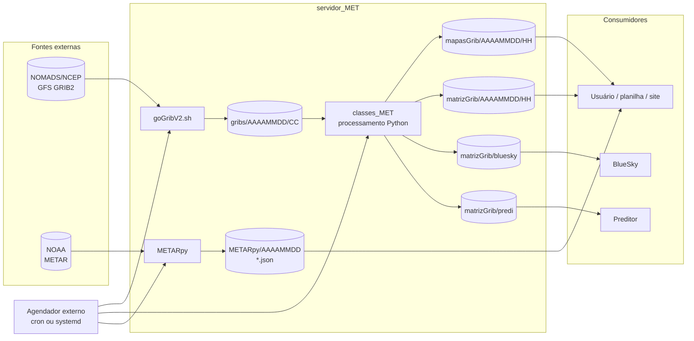

# servidor_MET — documentação técnica

Documentação do sistema batch `servidor_MET`, produzida a partir do código e dos dados presentes neste diretório em **19/10/2026**.

> **Escopo e limites desta entrega**
>
> - Formato: somente Markdown. Os diagramas usam blocos Mermaid e não geram imagens.
> - Nenhum arquivo de código-fonte foi alterado.
> - O diagnóstico descreve o comportamento **atual** do código, inclusive os defeitos. As correções são recomendações, não foram aplicadas.
> - O diretório `gribs/`, `mapasGrib/` e `matrizGrib/` deste checkout está vazio; a documentação dos produtos GFS foi feita pelo código, pelos scripts e por uma amostra real de GFS 0.25°. Os dados METAR históricos estão presentes.

## O que é o sistema

`servidor_MET` é um conjunto de scripts shell e Python que roda em lote para:

1. baixar GFS GRIB2 do NOMADS/NCEP;
2. gerar mapas PNG e matrizes CSV de variáveis meteorológicas;
3. gerar produtos específicos de vento para o BlueSky e para um preditor;
4. atender requisições manuais de mapas/matrizes para uma data, ciclo, região e nível;
5. coletar METAR de aeroportos brasileiros e gravar JSON bruto e traduzido.

O sistema **não é** um serviço HTTP/API, não usa banco de dados, fila, cache distribuído ou agendador interno. A integração é feita por arquivos em diretórios fixos e por um agendador externo (cron/systemd), que não está versionado neste repositório.

## Em 30 segundos

| Item | Valor |
|---|---|
| Base operacional | `/media/MET/servidor_MET` |
| Configuração de diretórios | `environment/path.conf` |
| Fonte GFS | `https://nomads.ncep.noaa.gov/pub/data/nccf/com/gfs/prod/` |
| Ciclos GFS usados | `00`, `06`, `12`, `18` UTC |
| Previsões baixadas | `f000`, `f006`, `f012`, `f018` |
| Resoluções | 0.25° (principal), 0.50° (fallback), 1.00° (fallback/baixada), legado `gfsYYYYMMDDCC00_000.grb` |
| Produtos automáticos | `mapasGrib/AAAAMMDD/HH/` e `matrizGrib/AAAAMMDD/HH/` |
| Produtos BlueSky | `matrizGrib/bluesky/AAAAMMDD/HH/` |
| Produtos do preditor | `matrizGrib/predi/AAAAMMDD/HH/` |
| Requisições manuais | `bash/reqs_MAN_MET.sh` → `classes_MET/executa_reqs_param.py` |
| METAR | `METARpy/AAAAMMDD/*.json` e `*_traduzido.json` |
| Estações METAR | SBGR, SBGL, SBCT, SBPA, SBCF, SBBE, SBEG, SBRF, SBFZ |
| Dados METAR no checkout | 158 diretórios de data, 16.044 JSONs, período 14/07/2021 a 17/12/2022 |

## Comece por

| Documento | Conteúdo |
|---|---|
| [01-arquitetura.md](01-arquitetura.md) | Contexto, componentes, dependências entre módulos, decisões e limites |
| [02-fluxos.md](02-fluxos.md) | Diagramas e descrição dos fluxos GFS, automático, manual e METAR |
| [03-dados-e-saidas.md](03-dados-e-saidas.md) | Variáveis, níveis, regiões, padrões de nomes, schemas CSV/JSON e volumes |
| [04-operacao.md](04-operacao.md) | Pré-requisitos, ordem de execução, comandos, cron, validação e troubleshooting |
| [05-diagnostico.md](05-diagnostico.md) | Bugs encontrados, evidências `arquivo:linha`, impacto, prioridade e plano de correção |
| [06-plano-de-melhorias-e-variaveis.md](06-plano-de-melhorias-e-variaveis.md) | Conclusões sobre nomenclatura/semântica das variáveis e plano de melhorias priorizado |

## Diagrama de contexto



## Estado atual e riscos principais

A lista completa, com evidências e recomendações, está em [05-diagnostico.md](05-diagnostico.md). Os riscos que mais afetam a confiança nos dados são:

| ID | Severidade | Achado | Efeito prático |
|---|---|---|---|
| D-01 | Crítica | Mapas e matrizes invertem a ordem das latitudes sem inverter os dados | Valores do norte aparecem no sul e vice-versa em todos os produtos GFS |
| D-02 | Crítica | Mapas de vento superficial e matriz do preditor usam U no lugar de V | Vetores e coluna V ficam errados; a matriz BlueSky usa o V correto |
| D-03 | Crítica | Altura de vento superficial convertida como se fosse pressão | Ventos de 20–80 m são gravados como 55.696–76.487 ft no BlueSky |
| D-04 | Alta | Seleção do ciclo GFS usa o ciclo anterior na primeira hora de cada ciclo | Produto rotulado `06` pode conter dados de `00`; idem `12`/`06` e `18`/`12` |
| D-05 | Alta | Chamadas de vento superficial e bloco duplicado são no-op | `winds` sem `-ns` e chamadas de 1000/200 sem `-v` não executam nada; os ventos em pressão das linhas 20-24 são gerados |
| D-06 | Alta | Umidade relativa superficial não gera saída | A chamada `umidadeRel -ns` existe, mas a lista de campos fica vazia |
| D-07 | Alta | JSONs METAR são abertos em modo append sem separador | 12 arquivos do checkout são JSON inválido por concatenação |

## Inventário rápido

| Caminho | Papel |
|---|---|
| `goGribV2.sh` | Download dos GFS para `gribs/AAAAMMDD/CC/` |
| `remove_GRIBS_antigos.sh` | Limpeza de GRIB e produtos com mais de 2 dias (com bug de virada de mês) |
| `bash/automatizacao_controle_MET.sh` | Orquestrador dos produtos automáticos |
| `bash/automatiza_MET.sh` | Wrapper dos produtos escalares |
| `bash/automatiza_vento_MET.sh` | Wrapper dos produtos de vento |
| `bash/reqs_MAN_MET.sh` | CLI posicional do fluxo manual |
| `classes_MET/` | Núcleo de leitura, seleção, mapas e matrizes |
| `METARpy/` | Coleta e tradução METAR; inclui vendor `PythonMETAR` |
| `environment/path.conf` | Diretórios de GRIB, mapas e matrizes |
| `gribs/`, `mapasGrib/`, `matrizGrib/` | Dados operacionais (vazios neste checkout) |

## Execução resumida

Os comandos abaixo refletem o código atual. Eles pressupõem que `/media/MET/servidor_MET` existe e que as dependências estão instaladas. Veja [04-operacao.md](04-operacao.md) para a sequência completa.

```bash
# 1. Baixar GFS do dia (data local)
cd /media/MET/servidor_MET
./goGribV2.sh

# 2. Gerar produtos automáticos
cd /media/MET/servidor_MET/bash
./automatizacao_controle_MET.sh

# 3. Requisição manual
./reqs_MAN_MET.sh \
  -v temp \
  -lonmin -56 -lonmax -42 -latmin -28 -latmax -18 \
  -nhpa 500 -datetime 202212170000 -out /tmp/saida/

# 4. Coletar METAR
cd /media/MET/servidor_MET/METARpy
./automatizaMetar.sh

# 5. Limpeza (executar com cautela; ver bug de virada de mês)
cd /media/MET/servidor_MET
./remove_GRIBS_antigos.sh
```

## Convenções desta documentação

- Caminhos de código são relativos à raiz do projeto, por exemplo `classes_MET/gera_mapas_MET.py:118`.
- `AAAAMMDD` representa a data no formato de oito dígitos.
- `CC` representa o ciclo GFS (`00`, `06`, `12`, `18`).
- `HH` representa o diretório de hora local usado na saída automática.
- `ff`/`FF` representa a previsão (`00`, `06`, `12`, `18`).
- Severidades: **Crítica** (dado errado ou perda relevante), **Alta** (produto ausente/errado em condição comum), **Média** (falha em condição específica ou risco operacional), **Baixa** (qualidade, manutenção ou usabilidade).
- “Bug” significa comportamento observado no código atual; “recomendação” é uma proposta de correção.

## Limitações da auditoria

- Não há logs de produção, testes automatizados, histórico Git ou documentação anterior.
- Não há arquivos GRIB nem produtos gerados neste checkout para comparar com os mapas/CSV históricos.
- `PythonMETAR` não está instalado no ambiente auditado; `METARpy/python-metar-master` é um vendor alternativo, mas `GoMETAR.py` importa o pacote `PythonMETAR`.
- Não foi possível confirmar o agendador real, o fuso horário do servidor nem as premissas dos consumidores BlueSky/preditor.
- As conclusões sobre orientação de grade foram verificadas com uma amostra real de GFS 0.25° do NOMADS e com a API `pygrib` (ver D-01 em [05-diagnostico.md](05-diagnostico.md)).
