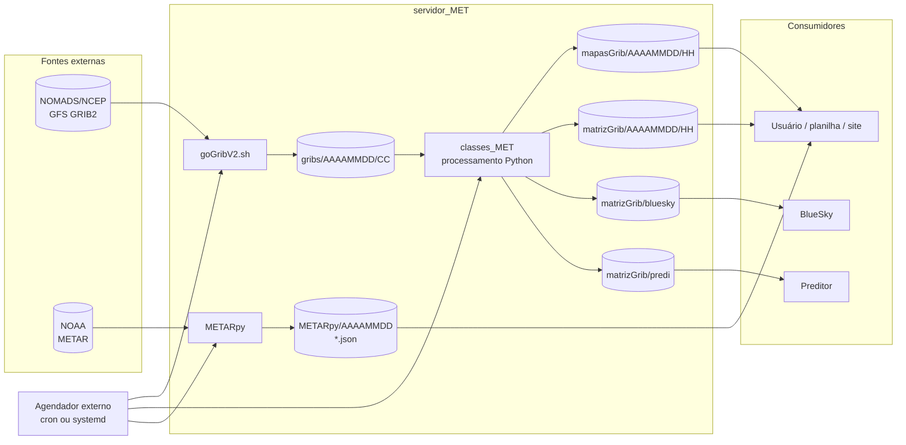

# servidor_MET — documentação técnica


> **Estado após as Fases 3 e 4:** robustez operacional implementada e Fase 4
> validada localmente. Consulte [11-fase-3-resultados.md](11-fase-3-resultados.md)
> e [12-fase-4-resultados.md](12-fase-4-resultados.md) para comportamento atual,
> testes, overrides e limites; o roteiro de aceite e promoção está em
> [14-ambiente-de-producao-e-aceitacao.md](14-ambiente-de-producao-e-aceitacao.md).
> Descrições abaixo preservam o histórico.

Documentação do sistema batch `servidor_MET`, produzida a partir do código e dos dados presentes neste diretório em **19/10/2026** e atualizada após as Fases 0, 1 e 2.

> **Escopo e limites desta entrega**
>
> - Formato: somente Markdown. Os diagramas usam blocos Mermaid e não geram imagens.
> - Os documentos 01–08 descrevem o código original em `main`, **antes** das correções da Fase 1. As seções de estado e os documentos 09/10 registram o que mudou na branch `execucao`.
> - A Fase 1 foi executada no worktree `METamorfose`, branch `execucao`; o resultado está em [09-fase-1-resultados.md](09-fase-1-resultados.md). A Fase 2 está em [10-fase-2-resultados.md](10-fase-2-resultados.md). O checkout principal e `/media/MET` permanecem sem as correções.
> - O diagnóstico descreve o comportamento original, inclusive os defeitos. As correções das Fases 1 e 2 já foram implementadas e validadas na branch `execucao`; a Fase 3 está no documento 11 e a Fase 4, validada localmente, no documento 12.
> - O aceite dos consumidores externos (BlueSky, preditor e planilhas) e a promoção em produção ainda não foram realizados. O ambiente de aceitação, os comandos e o registro de evidências estão no documento 14.
> - O diretório `gribs/`, `mapasGrib/` e `matrizGrib/` deste checkout está vazio; a documentação dos produtos GFS foi feita pelo código, pelos scripts e por uma amostra real de GFS 0.25°. Os dados METAR históricos estão presentes.

## O que é o sistema

`servidor_MET` é um conjunto de scripts shell e Python que roda em lote para:

1. baixar GFS GRIB2 do NOMADS/NCEP;
2. gerar mapas PNG e matrizes CSV de variáveis meteorológicas;
3. gerar produtos específicos de vento para o BlueSky e para um preditor;
4. atender requisições manuais de mapas/matrizes para uma data, ciclo, região e nível;
5. coletar METAR de aeroportos brasileiros e gravar JSON bruto e traduzido.

O sistema **não é** um serviço HTTP/API, não usa banco de dados, fila, cache distribuído ou agendador interno. A integração é feita por arquivos em diretórios fixos e por um agendador externo (cron/systemd), que não está versionado neste repositório.

## Em 30 segundos

| Item | Valor |
|---|---|
| Base operacional | `/media/MET/servidor_MET` |
| Configuração de diretórios | `environment/path.conf` |
| Fonte GFS | `https://nomads.ncep.noaa.gov/pub/data/nccf/com/gfs/prod/` |
| Ciclos GFS usados | `00`, `06`, `12`, `18` UTC |
| Previsões baixadas | `f000`, `f006`, `f012`, `f018` |
| Resoluções | 0.25° (principal), 0.50° (fallback), 1.00° (fallback/baixada), legado `gfsYYYYMMDDCC00_000.grb` |
| Produtos automáticos | `mapasGrib/AAAAMMDD/HH/` e `matrizGrib/AAAAMMDD/HH/` |
| Produtos BlueSky | `matrizGrib/bluesky/AAAAMMDD/HH/` |
| Produtos do preditor | `matrizGrib/predi/AAAAMMDD/HH/` |
| Requisições manuais | `bash/reqs_MAN_MET.sh` → `classes_MET/executa_reqs_param.py` |
| METAR | `METARpy/AAAAMMDD/*.json` e `*_traduzido.json` |
| Estações METAR | SBGR, SBGL, SBCT, SBPA, SBCF, SBBE, SBEG, SBRF, SBFZ |
| Dados METAR no checkout | 158 diretórios de data, 16.044 JSONs, período 14/07/2021 a 17/12/2022 |

## Comece por

| Documento | Conteúdo |
|---|---|
| [01-arquitetura.md](01-arquitetura.md) | Contexto, componentes, dependências entre módulos, decisões e limites |
| [02-fluxos.md](02-fluxos.md) | Diagramas e descrição dos fluxos GFS, automático, manual e METAR |
| [03-dados-e-saidas.md](03-dados-e-saidas.md) | Variáveis, níveis, regiões, padrões de nomes, schemas CSV/JSON e volumes |
| [04-operacao.md](04-operacao.md) | Pré-requisitos, ordem de execução, comandos, cron, validação e troubleshooting |
| [05-diagnostico.md](05-diagnostico.md) | Bugs encontrados, evidências `arquivo:linha`, impacto, prioridade e plano de correção |
| [06-plano-de-melhorias-e-variaveis.md](06-plano-de-melhorias-e-variaveis.md) | Conclusões sobre nomenclatura/semântica das variáveis e plano de melhorias priorizado |
| [07-fase-0-baseline.md](07-fase-0-baseline.md) | Backup, snapshot Git, amostra real de GFS, harness e baseline da Fase 0 |
| [08-contratos-e-consumidores.md](08-contratos-e-consumidores.md) | Contratos de CSV/JSON, headers, unidades, ordem das linhas e consumidores |
| [09-fase-1-resultados.md](09-fase-1-resultados.md) | Correções C-05/C-03/C-01/C-02/C-04, testes T-01–T-05, reprocessamento e validação independente |
| [10-fase-2-resultados.md](10-fase-2-resultados.md) | Correções C-06/C-07 e D-05–D-28 da Fase 2, testes T-06–T-12 e validação independente |
| [11-fase-3-resultados.md](11-fase-3-resultados.md) | Robustez operacional, D-16/D-18–D-23/D-26, testes T-13–T-15 e limites |
| [12-fase-4-resultados.md](12-fase-4-resultados.md) | Campanha real, validação de contratos, release/rollback e pendências externas |
| [13-comunicacao-consumidores.md](13-comunicacao-consumidores.md) | Mudanças de contrato para comunicar aos consumidores |
| [14-ambiente-de-producao-e-aceitacao.md](14-ambiente-de-producao-e-aceitacao.md) | Layout, ativação, testes por consumidor, evidências, assinatura, promoção e rollback |

## Fase 0 — preparação

A Fase 0 foi concluída antes de qualquer alteração de cálculo:

- backup em `/home/paulo/Documentos/meus_codigos/backups/servidor_MET-fase-0-20261023.tar.gz`;
- snapshot `servidor_MET` em `main` (`3bf69ee`) e início da branch `execucao`
  em `METamorfose` (`3bf74a1`);
- amostra real de GFS 0.25° com 20 mensagens e ponto de São Paulo validado;
- harness com **42 casos**: `22 passed, 20 xfailed(strict)`, sem `skip` quando a
  amostra está presente;
- suíte de aceitação com **18 testes**; suíte completa com `40 passed`,
  `20 xfailed(strict)` e 0 `skip`;
- baseline em `baseline/reports/20261022-00/`;
- `goGribV2.sh` congelado e nenhum código de produção alterado.

Instruções de teste: [tests/README.md](../tests/README.md). Resultado detalhado:
[07-fase-0-baseline.md](07-fase-0-baseline.md).

## Fase 1 — correções de cálculo

A Fase 1 foi executada no worktree `METamorfose`, branch `execucao`, sobre a
tag `fase-0-concluida`:

- C-05: seleção do ciclo GFS com intervalo semiaberto e caminhos absolutos;
- C-03: dados invertidos junto com a latitude, em mapas e matrizes;
- C-01: componente V corrigida no mapa superficial AUT e no preditor AUT;
- C-02: altura de `winds` convertida de metros para pés com flag explícita;
- C-04: `angMET` normalizado para `[0, 360)`;
- **123 testes verdes** (3 `deselected` de rede), incluindo **65 testes de
  aceitação** T-01 a T-05;
- 20 produtos reprocessados em `reprocessamento/reports/20261022-00/`;
- 13 CSVs comparados linha a linha com `pygrib` e 7 mapas gerados;
- validação independente com **158 verificações e 0 falhas**;
- 20 nomes de produtos e todos os headers preservados;
- baseline e `goGribV2.sh` intactos.

Resultado detalhado: [09-fase-1-resultados.md](09-fase-1-resultados.md).

## Fase 2 — produtos, CLI e METAR

A Fase 2 foi executada no mesmo worktree, sobre o commit `9288c1f`:

- C-06: `umidadeRel -ns` substituído por `-n 850`; `-ns` retorna erro claro; mapa usa `N850`;
- C-07: `winds -ns` ativado no controlador; bloco duplicado de 1000/200 removido;
- D-07/D-08: JSON METAR com escrita atômica e timestamp UTC com rollover;
- D-09: intervalo MAN aceita as duas ordens e devolve níveis crescentes;
- D-10: limpeza usa `date -d "-2 days"`, remove `0p25`, `1p00`, legados e produtos, e valida calendário;
- D-13/D-24/D-27: semântica de `chuvaNaoConvec`, rótulo `+6` e `temps` documentados sem renomear;
- D-14/D-28: CLI MAN migrado para `argparse`; wrappers com `set -euo pipefail`, help e faixa 150–1000 hPa;
- D-15: chamada duplicada de `gera_matriz` removida;
- D-17: checagem de nuvem corrigida para `is None`/`is not None`;
- D-25: variáveis indefinidas do shell METAR removidas;
- **162 testes verdes**, incluindo **36 testes de aceitação** T-06 a T-12;
- validação independente com **177 verificações e 0 falhas**;
- 20 produtos da Fase 1 preservados e `goGribV2.sh` congelado.

Resultado detalhado: [10-fase-2-resultados.md](10-fase-2-resultados.md).

## Fase 4 — ambiente e aceite

O ambiente de aceitação pode ser montado com
`python3 reprocessamento/setup_production_env.py` (padrão `~/MET/servidor_MET`).
Ele contém o código e os produtos da release candidata, 12 GRIBs históricos e
um `acceptance.json` pendente. Os scripts `bin/testar_*` verificam contratos e
geram uma amostra MAN; o teste nos aplicativos externos e o registro da
evidência continuam manuais. O roteiro completo, incluindo promoção e rollback,
está em [14-ambiente-de-producao-e-aceitacao.md](14-ambiente-de-producao-e-aceitacao.md).

## Diagrama de contexto



## Estado atual e riscos principais

A lista completa, com evidências e recomendações, está em [05-diagnostico.md](05-diagnostico.md). O estado por fase é:

| Fase | Escopo | Estado |
|---|---|---|
| 0 | Backup, baseline, harness e Git | Concluída |
| 1 | D-01, D-02, D-03, D-04, D-12 (C-01–C-05) | Concluída e validada |
| 2 | D-05, D-06, D-07, D-08, D-09, D-10, D-13, D-14, D-15, D-17, D-24, D-25, D-27, D-28 | Concluída e validada |
| 3 | D-16, D-18, D-19, D-20, D-21, D-22, D-23, D-26 e auditoria | Implementada; ver documento 11 |
| 4 | Reprocessamento e ensaio de release | Validado localmente; aceite externo/producao pendentes |

Fase 3: **182 testes locais aprovados**, 3 testes de remotos excluídos;
13 CSVs e 7 PNGs reais preservados byte a byte. Ver [documento 11](11-fase-3-resultados.md).
A Fase 4 foi validada localmente com **205 testes** e uma campanha real de
15–17/12/2022; ver [documento 12](12-fase-4-resultados.md).

Riscos que ainda exigem atenção operacional:

- Fase 4: aceite dos consumidores BlueSky/preditor/planilhas e promoção em
  produção pendentes; as previsões reais f006/f012/f018 já foram validadas
  localmente.
- 12 JSONs históricos inválidos preservados; a escrita nova é atômica.
- Retenção remove o dia alvo; não há quota/alerta de disco.
- Locks locais exigem `MET_LOCK_DIR` comum; não há coordenação distribuída.
- O downloader congelado não participa dos locks da geração.

Os defeitos operacionais D-16/D-18/D-20/D-26 foram tratados na Fase 3;
consulte [resultados e limites](11-fase-3-resultados.md).

## Inventário rápido

| Caminho | Papel |
|---|---|
| `goGribV2.sh` | Download dos GFS para `gribs/AAAAMMDD/CC/` (congelado) |
| `remove_GRIBS_antigos.sh` | Limpeza de GRIB e produtos do dia `hoje - 2` (corrigida na Fase 2) |
| `bash/automatizacao_controle_MET.sh` | Orquestrador dos produtos automáticos (retorna 0 só em sucesso; 75 em concorrência) |
| `bash/automatiza_MET.sh` | Wrapper dos produtos escalares, com validação |
| `bash/automatiza_vento_MET.sh` | Wrapper dos produtos de vento, com validação |
| `bash/reqs_MAN_MET.sh` | Wrapper fino do CLI manual; o parser é `argparse` |
| `classes_MET/` | Núcleo de leitura, seleção, mapas e matrizes |
| `METARpy/` | Coleta e tradução METAR com escrita atômica; inclui vendors |
| `environment/path.conf` | Diretórios de GRIB, mapas e matrizes |
| `gribs/`, `mapasGrib/`, `matrizGrib/` | Dados operacionais (vazios neste checkout) |
| `tests/` | Harness e testes de aceitação das Fases 0–4 |
| `reprocessamento/` | Amostra reprocessada e validadores independentes |

## Execução resumida

Os comandos abaixo refletem o código atual. Eles pressupõem que `/media/MET/servidor_MET` existe e que as dependências estão instaladas. Veja [04-operacao.md](04-operacao.md) para a sequência completa.

```bash
# 1. Baixar GFS do dia (data local)
cd /media/MET/servidor_MET
./goGribV2.sh

# 2. Gerar produtos automáticos
cd /media/MET/servidor_MET/bash
./automatizacao_controle_MET.sh

# 3. Requisição manual
./reqs_MAN_MET.sh \
  -v temp \
  -lonmin -56 -lonmax -42 -latmin -28 -latmax -18 \
  -nhpa 500 -datetime 202212170000 -out /tmp/saida/

# 4. Coletar METAR
cd /media/MET/servidor_MET/METARpy
./automatizaMetar.sh

# 5. Limpeza (executar com cautela; remove o dia hoje - 2)
cd /media/MET/servidor_MET
./remove_GRIBS_antigos.sh
```

## Convenções desta documentação

- Caminhos de código são relativos à raiz do projeto, por exemplo `classes_MET/gera_mapas_MET.py:118`.
- `AAAAMMDD` representa a data no formato de oito dígitos.
- `CC` representa o ciclo GFS (`00`, `06`, `12`, `18`).
- `HH` representa o diretório de hora local usado na saída automática.
- `ff`/`FF` representa a previsão (`00`, `06`, `12`, `18`).
- Severidades: **Crítica** (dado errado ou perda relevante), **Alta** (produto ausente/errado em condição comum), **Média** (falha em condição específica ou risco operacional), **Baixa** (qualidade, manutenção ou usabilidade).
- “Bug” significa comportamento observado no código atual; “recomendação” é uma proposta de correção.

## Limitações da auditoria

- No momento da auditoria original não havia logs de produção, testes automatizados, histórico Git ou documentação anterior. A Fase 0 adicionou harness, baseline e histórico Git; ver [07-fase-0-baseline.md](07-fase-0-baseline.md).
- Não havia arquivos GRIB nem produtos gerados neste checkout para comparar com os mapas/CSV históricos. A Fase 0 gerou uma amostra e um baseline próprios; ver [07-fase-0-baseline.md](07-fase-0-baseline.md).
- `PythonMETAR` não está instalado no ambiente auditado; `METARpy/python-metar-master` é um vendor alternativo, mas `GoMETAR.py` importa o pacote `PythonMETAR`.
- Não foi possível confirmar o agendador real, o fuso horário do servidor nem as premissas dos consumidores BlueSky/preditor.
- As conclusões sobre orientação de grade foram verificadas com uma amostra real de GFS 0.25° do NOMADS e com a API `pygrib` (ver D-01 em [05-diagnostico.md](05-diagnostico.md)).

## Estado da Fase 4

A implementacao e a validacao local estao em [12-fase-4-resultados.md](12-fase-4-resultados.md).
O rollout real e o aceite dos consumidores externos ainda estao pendentes.
Os nomes, headers, unidades e o downloader permanecem preservados.
